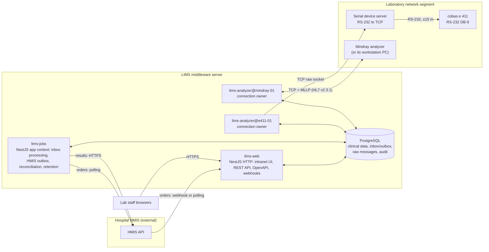
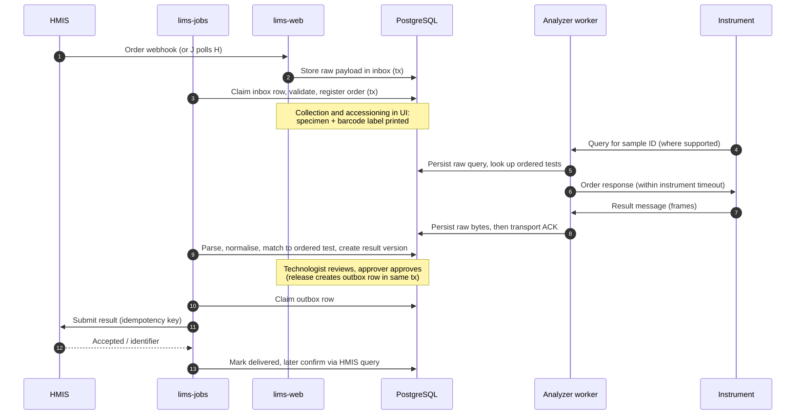
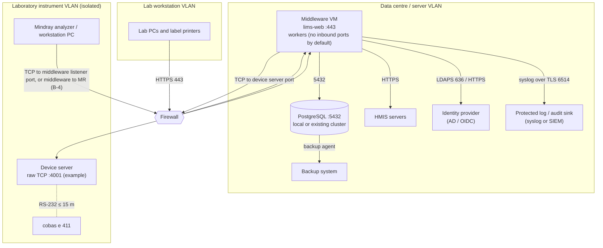

# 02. Architecture and Hospital Network

## 1. Logical architecture

The system is a **modular monolith**: one codebase, one database, several
independently supervised operating-system processes that share TypeScript
packages. Module boundaries are enforced in code (see
[05](05-modules-and-contracts.md)), not by network calls.

Key points:

* **Analyzer workers never call the HMIS.** They only write to the database
  (raw messages, inbox rows) and answer instrument queries from the database.
  An HMIS outage therefore never blocks an analyzer link.
* **The web process never owns an analyzer connection.** Restarting or
  upgrading the web process does not interrupt analyzer communication.
* **The jobs process** moves data between bounded contexts through the
  durable inbox/outbox tables (see [08](08-durable-processing.md)).
* Each process can be restarted on its own. The database is the only shared
  state.

## 2. Data flow, end to end

## 3. Hospital network topology

Port numbers shown are examples. Real values come from discovery (D-23, B-4)
and are recorded in the firewall request in
[11](11-installation-and-runbooks.md) §6.

### 3.1 Why a serial device server

The e 411 host port is RS-232 on a D-SUB 9 connector at the left side of the
analyzer, with a 15 m maximum cable length, one port, half duplex
[DOC e411 HIM B-2, B-7]. Hospital VMs normally have no COM port, and USB
pass-through to a VM is fragile. A serial device server in **raw TCP server
mode** next to the analyzer converts the link to TCP, so:

* the middleware VM can be anywhere on the network;
* the ASTM state machine still runs entirely in the middleware (the device
  server must not add its own protocol handling);
* the device server's serial settings must exactly match the analyzer
  (speed, data bits, parity, stop bits; [DOC e411 HIM B-2, B-6]);
* **[UNVERIFIED]** the device server must not buffer or coalesce data in a
  way that delays single-byte ACK/NAK/ENQ/EOT beyond the 15 s ASTM timeout.
  Configure "packing" or "delimiter" options off or to a short interval
  (milliseconds) and confirm during interface testing.

If the hospital prefers a physical server near the lab, the same adapter uses
a local serial port instead (see transport options in
[07](07-adapters-and-hmis-contracts.md)).

### 3.2 Cable

The e 411 manual's connection diagram shows a three-wire link: analyzer pin 2
(RXD) to host TXD, analyzer pin 3 (TXD) to host RXD, pin 5 signal ground to
host ground, with pins 7 and 8 bridged on the analyzer side
[DOC e411 HIM B-7, Fig. B-2]. The exact cable for a given device server
depends on its DB-9 pinout (DTE vs DCE) and must be confirmed with the device
server's documentation and the Roche engineer.

## 4. Trust boundaries

| Boundary | Traffic | Protection |
|---|---|---|
| Browser to middleware | UI and API | HTTPS with the hospital CA certificate, session cookie, CSRF tokens |
| HMIS to middleware | Webhooks (if used) | HTTPS, HMAC signature or mutual TLS (per HMIS capability), IP allow-list |
| Middleware to HMIS | Orders, results | HTTPS, credentials from the secret store |
| Middleware to analyzers | ASTM / HL7 | **Cleartext**. The instrument protocols in the documents we hold define no encryption. Mitigated by VLAN isolation and firewall allow-lists, see [10](10-security-and-audit.md) §6. |
| Middleware to database | SQL | Local socket or TLS; separate DB roles per process |
