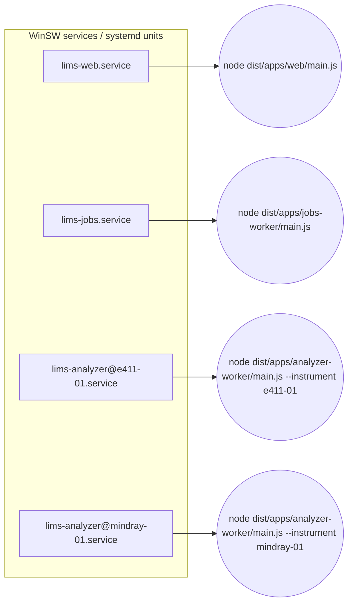

# 03. Stack Rationale and Process Deployment Topology

## 1. Technology choices

| Concern | Choice | Rationale | Notes / exceptions |
|---|---|---|---|
| Language | TypeScript, `strict: true`, `noUncheckedIndexedAccess`, `exactOptionalPropertyTypes`, `noImplicitOverride` | Typed domain contracts shared between processes | Types are not validation: every external input is parsed with a runtime schema |
| Runtime | Node.js **Active LTS** line at the time of the build, bundled with the installer | No runtime download on site | As of Nov 2026, check the official Node.js release schedule and choose the newest line in Active LTS whose native-module prebuilds (serialport) are published for the target OS/arch. Pin the exact version in `.nvmrc` and the build pipeline. |
| Application framework | NestJS | Modules, DI, guards, interceptors, MVC with Handlebars, OpenAPI generator, standalone application contexts for workers | One framework for web and worker processes |
| Database | PostgreSQL (a currently supported major version) | Transactions, `SELECT … FOR UPDATE SKIP LOCKED` for queues, `NUMERIC` for clinical values, JSONB for raw payload metadata, row-level permissions | Use the hospital's cluster if one exists (D-18) |
| ORM / migrations | Prisma, migrations generated with `prisma migrate dev`, **reviewed by a human**, committed, and applied in production with `prisma migrate deploy` | Typed queries, readable migration SQL | Queue claiming and a few integrity checks use `$queryRaw` tagged templates (always parameterised). Check whether the pinned Prisma version ships a native query engine; if it does, bundle the engine for each target platform. |
| UI | NestJS MVC + Handlebars + Bootstrap (vendored, no CDN) | Simple server-rendered pages work on locked-down hospital browsers; no SPA build chain on site | Small amounts of progressive-enhancement JavaScript only |
| Queues | PostgreSQL tables (inbox, outbox, job) | No Redis/RabbitMQ to install, patch, back up, or secure | Throughput needed (A-7) is far below PostgreSQL limits |
| Operational logging | Pino, JSON lines, to rotating files and optionally syslog | Fast, structured | Redaction paths configured centrally |
| Clinical audit | Separate append-only table + hash chain + export to protected sink | Audit must not mix with debug logs | See [10](10-security-and-audit.md) |
| API docs | `@nestjs/swagger` producing OpenAPI 3 | Published at `/api/docs` for authenticated admins only | |
| Runtime validation | **Zod** schemas in `packages/contracts` | One schema produces both the TypeScript type and the runtime parser; used for config, API DTOs (via a Nest pipe), HMIS payloads, and normalised analyzer messages | `class-validator` is avoided so there is only one validation system |
| Serial | `serialport` (with `@serialport/bindings-cpp` prebuilt N-API binaries) | Maintained, N-API means the binary is not tied to one Node ABI | Verify the prebuild for the exact OS/arch, see [11](11-installation-and-runbooks.md) §4 |
| TCP | Node `net` module | No extra dependency | Framing implemented in our own buffer-based codecs |
| Decimal maths | Prisma `Decimal` (decimal.js) | No float maths on clinical values | |
| Windows service wrapper | **WinSW** (MIT, maintained) | Wraps each Node process as a Windows service with restart policy and log rotation | NSSM is not used because it is no longer maintained |
| Linux supervision | systemd units with `Restart=on-failure`, hardening options | Standard on supported distros | |

### Justified exceptions

* **No Redis, RabbitMQ, Kubernetes, or Docker** are required. None is
  justified at the expected load.
* **A serial device server** (hardware) is likely required for RS-232
  instruments when the middleware runs on a VM (A-1). It is a hardware
  dependency, not a software service.
* **PostgreSQL** must be installed if the hospital has no existing cluster.
  The installer can install it from a bundled, signed vendor package, or
  connect to an existing instance.

## 2. Repository layout (npm workspaces)

```
apps/
  web/                 NestJS HTTP app: UI, REST API, webhooks
  analyzer-worker/     NestJS application context; owns ONE instrument connection
  jobs-worker/         NestJS application context; inbox, outbox, reconciliation, retention
packages/
  contracts/           Zod schemas + inferred types shared by all processes
  domain/              Pure domain logic (state machines, matching, value parsing)
  db/                  Prisma schema, migrations, repository helpers, queue SQL
  config/              Config loading + Zod validation, secret providers
  audit/               Clinical audit writer, hash chain, exporter
  logging/             Pino factory with redaction rules
  protocol-astm/       ASTM E1381 low-level codec + E1394 record parser (no I/O)
  protocol-hl7v2/      MLLP codec + HL7 v2 parser/encoder (no I/O)
  adapters/            Model-specific adapters (cobas-e411, mindray-bc-hl7, …)
  transport/           Serial and TCP transports, backpressure, connection lease
  simulators/          Instrument and HMIS simulators for tests
tools/
  build/               Offline bundle builder, SBOM, checksums
  installer/           Windows (WiX/WinSW) and Linux (systemd, tarball) assets
docs/
```

Rules:

* `protocol-*` packages perform **no I/O and no database access**. They take
  `Buffer`s in and return frames, records, or errors. This makes them fully
  unit-testable with byte fixtures.
* `domain` has no NestJS or Prisma imports.
* Apps import packages; packages never import apps. A lint rule
  (`eslint-plugin-boundaries` or dependency-cruiser) enforces this.

## 3. Process topology

| Process | Count | Owns | Restart effect |
|---|---|---|---|
| `lims-web` | 1 (can be 2 behind a local reverse proxy later) | HTTP port, UI sessions, webhooks | Users see a brief outage. Analyzers unaffected. Webhooks retried by HMIS (to confirm D-3). |
| `lims-jobs` | 1 (safe to run 2: queue claims use leases) | Inbox processing, outbox delivery, reconciliation, retention, monitoring probes | Work pauses and resumes from durable queues. |
| `lims-analyzer@<instrumentId>` | **1 per configured instrument connection** | That instrument's serial port or TCP socket, and its connection lease row | Only that instrument's link drops; it reconnects. |



**Why one process per instrument?** A fault in one driver (an unhandled
exception, a native serial module crash, a memory leak from a malformed
message) cannot take down another instrument's link. Each process is small
(about 60 to 100 MB resident, to be measured).

### 3.1 Connection ownership

Two processes must never talk to the same instrument at the same time
(for example after an operator starts a second copy by hand, or during an
upgrade). Ownership is enforced at three levels:

1. **Database lease.** On start, the worker runs
   `UPDATE instrument_connection_lease SET owner = $me, lease_until = now() + 30s, epoch = epoch + 1 WHERE instrument_id = $id AND (lease_until < now() OR owner = $me) RETURNING epoch`.
   No row returned means another owner is alive, so the worker exits with a
   clear log line. The lease is renewed every 10 s. If renewal fails (DB
   unreachable or lost to another owner), the worker **closes the port
   immediately** and stops sending ACKs, so the instrument retries later.
2. **Fencing token.** Every raw-message insert carries the lease `epoch`. A
   trigger rejects inserts with a stale epoch, so a paused "zombie" process
   cannot write after losing the lease.
3. **Operating system.** A serial port can only be opened once, and a TCP
   listener port can only be bound once. These are a backstop, not the
   primary control, because TCP **client** connections to a device server are
   not exclusive (some device servers accept several clients; configure them
   to allow one).

### 3.2 Keeping the event loop responsive

* Framing, checksum, and record parsing are O(n) over messages of a few KB
  and run inline.
* Mindray results can carry Base64 histograms and BMP scattergrams in OBX-5
  (`ED` type) [DOC Mindray 6.2]. Decoding and storing those is done by the
  jobs worker, not on the connection's hot path. The analyzer worker stores
  the raw bytes and ACKs.
* If profiling shows any parse step above ~20 ms, it moves to a
  `worker_threads` pool (`piscina`). The event-loop delay is exported as a
  metric (`perf_hooks.monitorEventLoopDelay`) and alarmed at p99 > 100 ms.
