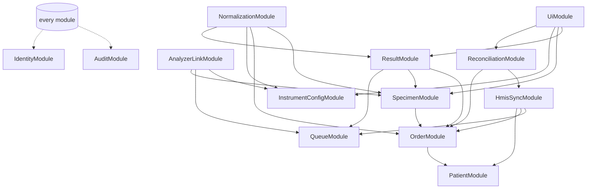

# 05. NestJS Module Structure and Shared TypeScript Contracts

## 1. Modules

Each module owns its tables. Other modules call it through an exported
service interface, never through its Prisma models directly. Cross-module
side effects that must survive a crash go through the outbox (see
[08](08-durable-processing.md)).

| Module | Responsibility | Owns tables | Runs in |
|---|---|---|---|
| `IdentityModule` | Users, roles, sessions, OIDC/LDAP login, permission guard | `user`, `role`, `user_role`, `session` | web |
| `PatientModule` | Patients, encounters, external identifiers, merge handling | `patient`, `patient_identifier`, `encounter` | web, jobs |
| `OrderModule` | Orders, ordered tests, cancellations | `lab_order`, `ordered_test` | web, jobs |
| `SpecimenModule` | Specimens, accessions, barcodes, collection, rejection, recollection, label printing | `specimen`, `accession`, `barcode_assignment`, `specimen_event` | web, jobs |
| `InstrumentConfigModule` | Instruments, connection settings, versioned test mappings, flag/unit maps | `instrument`, `instrument_connection`, `test_mapping_set`, `test_mapping`, `value_map` | web (edit), workers (read) |
| `AnalyzerLinkModule` | Transport, framing, protocol state machines, connection lease, raw message capture, query answering | `instrument_connection_lease`, `raw_message`, `raw_frame`, `link_session` | analyzer-worker |
| `NormalizationModule` | Parse raw messages into normalised observations, classify patient vs QC vs calibration, match to specimen and ordered test | `normalized_message`, `observation`, `unmatched_result`, `qc_result` | jobs |
| `ResultModule` | Result versions, review, approval, release, corrections, critical-result workflow | `result`, `result_version`, `approval`, `release`, `critical_notification` | web, jobs |
| `HmisSyncModule` | HMIS client, order intake (webhook/poll), result delivery, delivery confirmation, code maps | `hmis_cursor`, `hmis_code_map`, `delivery_attempt` | web (webhook), jobs |
| `QueueModule` | Inbox/outbox/job tables, claiming, leases, retries, dead-letter, replay | `inbox_message`, `outbox_message`, `job` | jobs, web (enqueue), workers (enqueue) |
| `ReconciliationModule` | Downtime registrations, HMIS order matching, delivery confirmation sweeps, unmatched-result resolution | `reconciliation_case` | jobs, web |
| `AuditModule` | Clinical audit events with hash chain, export | `audit_event`, `audit_export` | all (write), web (read) |
| `MonitoringModule` | Health and readiness probes, metrics, disk and queue-age checks, alerts | `health_snapshot` | all |
| `UiModule` | Handlebars views, layouts, flash messages, CSRF | none | web |

### 1.1 Dependency direction



`AnalyzerLinkModule` reads the specimen/order tables only to answer queries
(read-only port `OrderQueryPort`). It never creates results. Results are
created by `NormalizationModule` in the jobs process. This keeps the analyzer
worker small and keeps clinical logic out of the connection path.

### 1.2 Layering inside the analyzer path

| Layer | Package | Knows about |
|---|---|---|
| Transport | `packages/transport` | Bytes, sockets, serial ports, backpressure. Nothing about ASTM or HL7. |
| Framing / link protocol | `packages/protocol-astm`, `packages/protocol-hl7v2` | Control characters, frames, checksums, MLLP blocks, link state machine. No database. |
| Message parsing | same packages | Records/segments into typed structures. Rejects malformed input with typed errors. |
| Instrument adapter | `packages/adapters/<model>` | Model-specific field meanings, mapping to `NormalizedAnalyzerMessage`. |
| Domain validation | `packages/domain` | Matching rules, value parsing, state transitions. |
| Persistence | `packages/db` | Prisma, transactions, queue SQL. |

## 2. Shared contracts (`packages/contracts`)

All contracts are Zod schemas. The TypeScript type is inferred from the
schema, so the runtime check and the compile-time type cannot drift. The
examples below are **illustrative**; field lists are finalised once the HMIS
and instruments are confirmed.

### 2.1 Identifiers

```ts
import { z } from 'zod';

// Branded string IDs prevent passing an accession where a specimen ID is expected.
export const Uuid = z.string().uuid();
export const PatientId = Uuid.brand<'PatientId'>();
export const SpecimenId = Uuid.brand<'SpecimenId'>();
export const AccessionNo = z.string().regex(/^[A-Z0-9]{6,20}$/).brand<'AccessionNo'>(); // format TBC (B-8)
export const Barcode = z.string().min(1).max(22).regex(/^[\x21-\x7E]+$/).brand<'Barcode'>(); // e411 max 22
export const InstrumentId = z.string().regex(/^[a-z0-9-]{3,40}$/).brand<'InstrumentId'>();
export const CorrelationId = Uuid.brand<'CorrelationId'>();
```

### 2.2 Clinical value (no floating point)

```ts
// A numeric clinical value is carried as a decimal STRING plus the original text.
export const DecimalString = z.string().regex(/^[+-]?\d+(\.\d+)?$/);

export const ResultValue = z.discriminatedUnion('kind', [
  z.object({ kind: z.literal('numeric'), value: DecimalString, scale: z.number().int().min(0).max(10) }),
  z.object({
    kind: z.literal('censored'),               // "<0.01", ">1000"
    comparator: z.enum(['<', '<=', '>', '>=']),
    limit: DecimalString,
  }),
  z.object({ kind: z.literal('qualitative'), code: z.string().max(40), display: z.string().max(200) }),
  z.object({ kind: z.literal('text'), text: z.string().max(4000) }),
  z.object({ kind: z.literal('absent'), reason: z.enum(['no-result', 'not-performed', 'masked']) }),
]);

export const Observation = z.object({
  instrumentTestCode: z.string().min(1).max(40),    // e.g. e411 host code "10", Mindray "6690-2"
  instrumentCodeSystem: z.string().max(20).optional(), // e.g. "LN", "99MRC"
  originalValueText: z.string().max(65535),         // exactly as received, never altered
  value: ResultValue,
  units: z.string().max(40).optional(),
  referenceRangeText: z.string().max(90).optional(),
  abnormalFlags: z.array(z.string().max(5)).default([]),
  instrumentFlags: z.array(z.object({ code: z.string(), text: z.string().optional() })).default([]),
  resultStatus: z.enum(['initial', 'rerun', 'final', 'unknown']),
  dilution: z.string().max(20).optional(),
  editedOnInstrument: z.boolean().default(false),   // Mindray OBX-13 E/e
  completedAt: z.string().datetime({ offset: true }).optional(),
  operatorId: z.string().max(40).optional(),
});
```

### 2.3 Normalised analyzer message

```ts
export const SampleClass = z.enum(['patient', 'qc', 'calibration', 'unknown']);

export const NormalizedAnalyzerMessage = z.object({
  schemaVersion: z.literal(1),
  rawMessageId: Uuid,                  // FK to raw_message; traceability anchor
  instrumentId: InstrumentId,
  adapter: z.object({ name: z.string(), version: z.string() }), // e.g. cobas-e411 / 1.0.0
  receivedAt: z.string().datetime({ offset: true }),
  kind: z.enum(['result', 'order-query', 'query-cancel', 'status']),
  sampleClass: SampleClass,
  sampleId: z.string().max(40).optional(),         // as sent; may be "@123" on e411 read error
  sampleIdReadError: z.boolean().default(false),
  qc: z.object({ controlName: z.string().optional(), lot: z.string().optional(), level: z.string().optional() }).optional(),
  instrumentContext: z.record(z.string(), z.string()).default({}), // seq no, carrier, position…
  observations: z.array(Observation).default([]),
  warnings: z.array(z.object({ code: z.string(), detail: z.string() })).default([]),
});
export type NormalizedAnalyzerMessage = z.infer<typeof NormalizedAnalyzerMessage>;
```

### 2.4 Status vocabularies shared with the UI

```ts
export const ResultDisplayStatus = z.enum([
  'received',        // stored from analyzer, not yet reviewed
  'reviewed',        // technologist reviewed
  'approved',        // authorised by approver
  'queued',          // release created outbox row
  'sent',            // HMIS accepted the request (2xx)
  'hmis_confirmed',  // HMIS state read back and matches
  'failed',          // delivery exhausted retries or rejected
]);
```

### 2.5 Configuration schema (excerpt)

```ts
export const SerialTransport = z.object({
  type: z.literal('serial'),
  path: z.string(),                         // "COM3" or "/dev/ttyUSB0"
  baudRate: z.union([z.literal(4800), z.literal(9600), z.literal(19200)]), // e411 [DOC B-2]
  dataBits: z.union([z.literal(7), z.literal(8)]),
  parity: z.enum(['none', 'even', 'odd']),
  stopBits: z.union([z.literal(1), z.literal(2)]),
  flowControl: z.enum(['none', 'rtscts', 'xonxoff']).default('none'), // c 111 default is XON/XOFF [DOC c111 HIM 6.3]
});
export const TcpClientTransport = z.object({
  type: z.literal('tcp-client'),
  host: z.string(), port: z.number().int().min(1).max(65535),
  connectTimeoutMs: z.number().int().default(5000),
  keepAliveMs: z.number().int().default(30000),
});
export const TcpServerTransport = z.object({
  type: z.literal('tcp-server'),
  bindAddress: z.string().default('0.0.0.0'), port: z.number().int(),
  allowedPeers: z.array(z.string().ip()).min(1),   // reject anything else
  maxConnections: z.literal(1).default(1),
});
export const InstrumentConnectionConfig = z.object({
  instrumentId: InstrumentId,
  adapter: z.enum(['cobas-e411-astm', 'cobas-c111-astm', 'mindray-hl7-mllp']),
  adapterOptions: z.record(z.string(), z.unknown()),   // validated by the adapter's own schema
  transport: z.discriminatedUnion('type', [SerialTransport, TcpClientTransport, TcpServerTransport]),
  maxMessageBytes: z.number().int().max(16 * 1024 * 1024).default(4 * 1024 * 1024),
});
```

Configuration loads in this order: defaults, file (`config/*.yaml`),
environment variables, secret provider. The merged object is parsed with the
schema at start-up; a process **refuses to start** on any validation error
and prints the path of each invalid key (never the value of a secret).

### 2.6 Validation points

| Input | Validated by | On failure |
|---|---|---|
| Config file and env | `AppConfig` schema at start | Process exits non-zero, service manager shows error |
| HTTP request bodies, query strings | `ZodValidationPipe` on every controller | 400 with field errors |
| HMIS webhook / poll responses | HMIS payload schemas | Stored in inbox as `invalid`, alert, no clinical effect |
| HMIS responses to result submission | Response schema | Treated as **ambiguous**, goes to confirmation sweep |
| Instrument frames | Codec (checksum, framing, size) | NAK / AE as protocol allows, raw bytes logged to `raw_frame` |
| Parsed instrument message | Adapter schema then `NormalizedAnalyzerMessage` | Quarantined (`unmatched_result` with reason) |
| DB reads of JSON columns | Same schema on read | Logged as data-integrity error |
