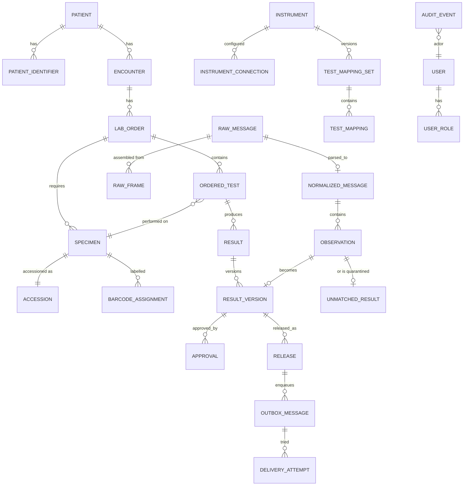
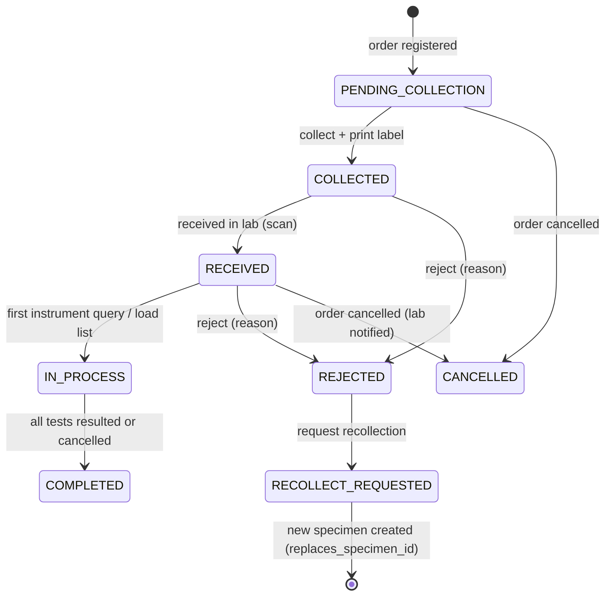
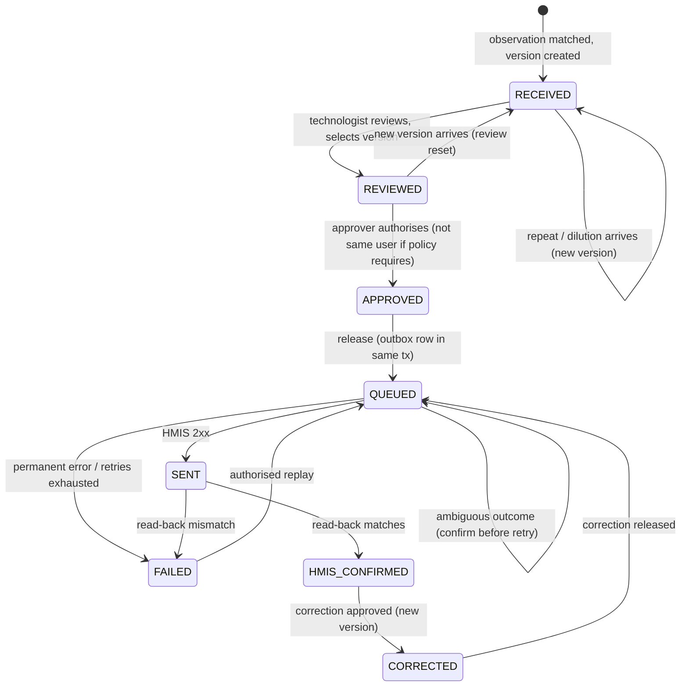
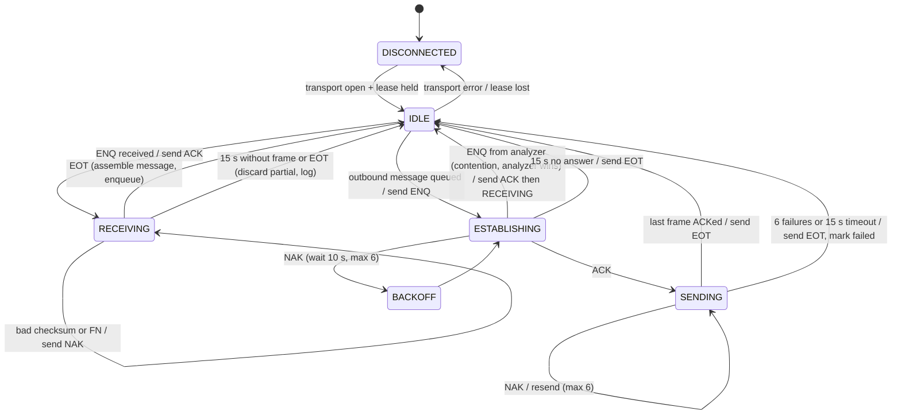
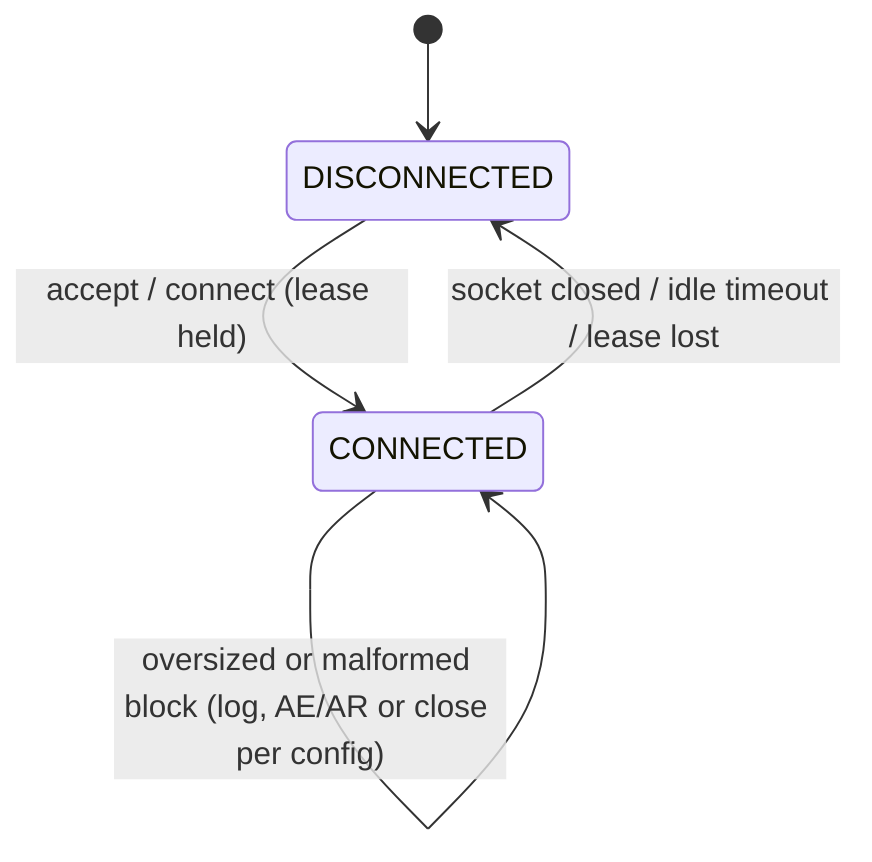
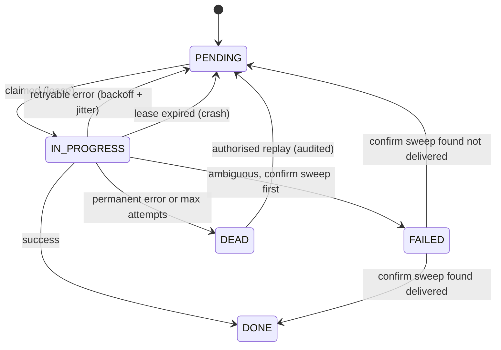

# 06. Database Schema and Workflow State Machines

## 1. Conventions

* All timestamps are `timestamptz` and stored in UTC. The UI renders them in
  the hospital's configured IANA time zone (`config.site.timeZone`, e.g.
  `Africa/Nairobi`). Instrument timestamps without zone (ASTM `YYYYMMDDHHMMSS`,
  HL7 TS without offset) are interpreted in the **instrument's configured
  zone** and the original text is kept alongside.
* Clinical numeric values use `NUMERIC` (Prisma `Decimal`). The original
  instrument text is always kept in a separate column.
* Primary keys are UUIDv7 (time-ordered, generated in the application).
* No hard deletes of clinical rows. Rows carry `status` or are superseded by
  a new version.
* Every table that changes clinical state has `created_at`, `created_by`, and
  a `version` integer for optimistic concurrency.

## 2. Entity overview



## 3. Prisma schema (draft)

This draft shows structure and constraints. Constraints Prisma cannot
express (partial unique indexes, CHECKs, triggers) are added by hand in the
reviewed migration SQL, shown after the schema.

```prisma
generator client {
  provider = "prisma-client-js"
}
datasource db {
  provider = "postgresql"
  url      = env("DATABASE_URL")
}

// ---------- Patients & encounters ----------
model Patient {
  id          String   @id @db.Uuid
  familyName  String?
  givenName   String?
  birthDate   DateTime? @db.Date
  sex         String?   // HMIS code, mapped for display
  provisional Boolean  @default(false) // created during HMIS downtime
  mergedIntoId String? @db.Uuid
  createdAt   DateTime @default(now()) @db.Timestamptz
  version     Int      @default(1)
  identifiers PatientIdentifier[]
  encounters  Encounter[]
}

model PatientIdentifier {
  id        String  @id @db.Uuid
  patientId String  @db.Uuid
  system    String  // e.g. "hmis-mrn", "national-id"
  value     String
  active    Boolean @default(true)
  patient   Patient @relation(fields: [patientId], references: [id])
  @@unique([system, value])           // an active MRN maps to exactly one patient
}

model Encounter {
  id             String   @id @db.Uuid
  patientId      String   @db.Uuid
  hmisEncounterId String? @unique
  type           String?  // inpatient, outpatient, emergency (HMIS code)
  location       String?
  startedAt      DateTime? @db.Timestamptz
  patient        Patient  @relation(fields: [patientId], references: [id])
  orders         LabOrder[]
}

// ---------- Orders, specimens, accessions ----------
model LabOrder {
  id            String   @id @db.Uuid
  encounterId   String   @db.Uuid
  hmisOrderId   String?  // null for downtime orders until reconciled
  source        OrderSource
  status        OrderStatus
  priority      Priority @default(ROUTINE)
  orderedAt     DateTime @db.Timestamptz
  orderingClinician String?
  version       Int      @default(1)
  encounter     Encounter @relation(fields: [encounterId], references: [id])
  tests         OrderedTest[]
  specimens     Specimen[]
  @@unique([hmisOrderId])
}

model OrderedTest {
  id            String   @id @db.Uuid
  orderId       String   @db.Uuid
  hmisLineId    String?
  localTestCode String   // middleware catalogue code
  specimenId    String?  @db.Uuid
  status        OrderedTestStatus
  cancelReason  String?
  order         LabOrder @relation(fields: [orderId], references: [id])
  specimen      Specimen? @relation(fields: [specimenId], references: [id])
  results       Result[]
  @@unique([orderId, hmisLineId])
}

model Specimen {
  id             String   @id @db.Uuid
  orderId        String   @db.Uuid
  specimenType   String   // serum, EDTA whole blood… (catalogue code)
  status         SpecimenStatus
  collectedAt    DateTime? @db.Timestamptz
  collectedBy    String?
  receivedAt     DateTime? @db.Timestamptz
  rejectedReason String?
  replacesSpecimenId String? @db.Uuid   // recollection chain
  version        Int      @default(1)
  order          LabOrder @relation(fields: [orderId], references: [id])
  accession      Accession?
  barcodes       BarcodeAssignment[]
  tests          OrderedTest[]
}

model Accession {
  id          String   @id @db.Uuid
  specimenId  String   @unique @db.Uuid
  accessionNo String   @unique          // never reused
  createdAt   DateTime @default(now()) @db.Timestamptz
  specimen    Specimen @relation(fields: [specimenId], references: [id])
}

model BarcodeAssignment {
  id         String   @id @db.Uuid
  specimenId String   @db.Uuid
  barcode    String   // printed value sent to instruments
  active     Boolean  @default(true)
  assignedAt DateTime @default(now()) @db.Timestamptz
  retiredAt  DateTime? @db.Timestamptz
  retiredReason String?
  specimen   Specimen @relation(fields: [specimenId], references: [id])
  // partial unique index in SQL: one ACTIVE assignment per barcode
}

// ---------- Instruments & mappings ----------
model Instrument {
  id          String @id           // e.g. "e411-01"
  displayName String
  manufacturer String
  model       String               // "cobas e 411"
  serialNo    String?
  softwareVersion String?          // as registered; compared with what the instrument reports
  verifiedSoftwareVersion String?  // version the current status was granted for
  discipline  String
  location    String?
  interfaceManualRef String?       // required for generic profiles
  verificationStatus VerificationStatus @default(UNVERIFIED)
  enabled     Boolean @default(false)
  connections InstrumentConnection[]
  mappingSets TestMappingSet[]
  evidence    InstrumentVerificationEvidence[]
}

// Append-only. Each row moves the status (see 14-adding-instruments.md §3).
model InstrumentVerificationEvidence {
  id           String   @id @db.Uuid
  instrumentId String
  kind         String   // interface-test, lab-acceptance, suspension, reverification
  evidenceJson Json     // validated by VerificationEvidence
  fromStatus   VerificationStatus
  toStatus     VerificationStatus
  recordedBy   String
  recordedAt   DateTime @default(now()) @db.Timestamptz
  instrument   Instrument @relation(fields: [instrumentId], references: [id])
}

model InstrumentConnection {
  id           String   @id @db.Uuid
  instrumentId String
  configJson   Json     // validated by InstrumentConnectionConfig on write and read
  activeFrom   DateTime @db.Timestamptz
  activeTo     DateTime? @db.Timestamptz
  createdBy    String
  instrument   Instrument @relation(fields: [instrumentId], references: [id])
}

model InstrumentConnectionLease {
  instrumentId String   @id
  owner        String   // host:pid:bootId
  epoch        BigInt   // fencing token
  leaseUntil   DateTime @db.Timestamptz
}

model TestMappingSet {
  id           String   @id @db.Uuid
  instrumentId String
  versionNo    Int
  status       MappingStatus  // DRAFT, APPROVED, ACTIVE, RETIRED
  approvedBy   String?
  approvedAt   DateTime? @db.Timestamptz
  activeFrom   DateTime? @db.Timestamptz
  instrument   Instrument @relation(fields: [instrumentId], references: [id])
  mappings     TestMapping[]
  @@unique([instrumentId, versionNo])
}

model TestMapping {
  id                 String @id @db.Uuid
  mappingSetId       String @db.Uuid
  localTestCode      String
  instrumentTestCode String       // e411 host test code; Mindray OBX-3 ID
  instrumentCodeSystem String?    // "LN", "99MRC"
  direction          MappingDirection // ORDER, RESULT, BOTH
  expectedUnits      String?
  unitConversion     Json?        // e.g. {"from":"g/L","to":"g/dL","factor":"0.1"} as decimal strings
  decimals           Int?
  qualitativeMap     Json?        // e.g. {"-1":"NEG","0":"BORDERLINE","1":"POS"}
  reportable         Boolean @default(true)  // false for histograms, RUO params
  ruo                Boolean @default(false)
  mappingSet         TestMappingSet @relation(fields: [mappingSetId], references: [id])
  @@unique([mappingSetId, instrumentTestCode, instrumentCodeSystem, direction])
}

// ---------- Raw and normalised messages ----------
model RawMessage {
  id            String   @id @db.Uuid
  instrumentId  String
  leaseEpoch    BigInt
  direction     Direction       // IN, OUT
  protocol      String          // "astm-e1381", "hl7-mllp"
  bytes         Bytes           // exact bytes, restricted access
  sha256        String
  receivedAt    DateTime @db.Timestamptz
  transportAck  TransportAck    // PENDING, ACKED, NAKED, NOT_APPLICABLE
  dedupeKey     String?         // see 08 §5
  linkSessionId String? @db.Uuid
  frames        RawFrame[]
  @@index([instrumentId, receivedAt])
}

model RawFrame {
  id           String @id @db.Uuid
  rawMessageId String? @db.Uuid
  linkSessionId String @db.Uuid
  seq          Int
  bytes        Bytes
  checksumOk   Boolean
  receivedAt   DateTime @db.Timestamptz
  rawMessage   RawMessage? @relation(fields: [rawMessageId], references: [id])
}

model NormalizedMessage {
  id            String @id @db.Uuid
  rawMessageId  String @unique @db.Uuid
  adapterName   String
  adapterVersion String
  mappingSetId  String? @db.Uuid
  payload       Json      // NormalizedAnalyzerMessage
  sampleClass   String
  createdAt     DateTime @default(now()) @db.Timestamptz
  observations  Observation[]
}

model Observation {
  id                  String @id @db.Uuid
  normalizedMessageId String @db.Uuid
  instrumentTestCode  String
  originalValueText   String
  numericValue        Decimal? @db.Decimal(20, 10)
  comparator          String?
  units               String?
  flags               String[]
  matchStatus         MatchStatus   // MATCHED, UNMATCHED, QC, IGNORED
  normalizedMessage   NormalizedMessage @relation(fields: [normalizedMessageId], references: [id])
}

// ---------- Results ----------
model Result {
  id             String @id @db.Uuid
  orderedTestId  String @db.Uuid
  currentVersionNo Int
  status         ResultStatus
  orderedTest    OrderedTest @relation(fields: [orderedTestId], references: [id])
  versions       ResultVersion[]
  @@unique([orderedTestId])
}

model ResultVersion {
  id              String @id @db.Uuid
  resultId        String @db.Uuid
  versionNo       Int
  kind            ResultVersionKind // INITIAL, REPEAT, DILUTION, CORRECTION, MANUAL_ENTRY
  observationId   String? @db.Uuid  // null for manual entry
  valueText       String            // display value as reported
  numericValue    Decimal? @db.Decimal(20, 10)
  comparator      String?
  units           String?
  referenceRange  String?
  abnormalFlag    String?
  isCritical      Boolean @default(false)
  selectedForRelease Boolean @default(false)
  reason          String?           // required for CORRECTION
  createdAt       DateTime @default(now()) @db.Timestamptz
  createdBy       String
  result          Result @relation(fields: [resultId], references: [id])
  approvals       Approval[]
  releases        Release[]
  @@unique([resultId, versionNo])
}

model Approval {
  id              String       @id @db.Uuid
  resultVersionId String       @db.Uuid
  step            ApprovalStep
  userId          String       @db.Uuid
  at              DateTime     @db.Timestamptz
  comment         String?
  resultVersion   ResultVersion @relation(fields: [resultVersionId], references: [id])
}

// Only written when autoverification is enabled for a test after documented validation.
model AutoverificationDecision {
  id              String   @id @db.Uuid
  resultVersionId String   @db.Uuid
  ruleSetVersion  String
  passed          Boolean
  details         Json
  at              DateTime @db.Timestamptz
}

model Release {
  id              String      @id @db.Uuid
  resultVersionId String      @db.Uuid
  releasedBy      String      @db.Uuid
  releasedAt      DateTime    @db.Timestamptz
  kind            ReleaseKind
  resultVersion   ResultVersion @relation(fields: [resultVersionId], references: [id])
}

// ---------- Queues ----------
model InboxMessage {
  id           String   @id @db.Uuid
  source       String   // "hmis-webhook", "hmis-poll", "analyzer:e411-01"
  externalId   String   // provider message id, or raw_message id
  payload      Json?
  rawMessageId String?  @db.Uuid
  status       QueueStatus
  attempts     Int      @default(0)
  availableAt  DateTime @db.Timestamptz
  leasedBy     String?
  leaseUntil   DateTime? @db.Timestamptz
  lastError    String?
  createdAt    DateTime @default(now()) @db.Timestamptz
  @@unique([source, externalId])     // idempotent intake
  @@index([status, availableAt])
}

model OutboxMessage {
  id             String   @id @db.Uuid
  topic          String   // "hmis.result.submit", "hmis.result.correct", "hmis.order.ack"
  aggregateId    String   @db.Uuid
  idempotencyKey String   @unique
  payload        Json
  status         QueueStatus
  attempts       Int      @default(0)
  availableAt    DateTime @db.Timestamptz
  leasedBy       String?
  leaseUntil     DateTime? @db.Timestamptz
  orderingKey    String   // e.g. result id: one in-flight message per key
  createdAt      DateTime @default(now()) @db.Timestamptz
  attemptsLog    DeliveryAttempt[]
  @@index([status, availableAt])
}

model DeliveryAttempt {
  id            String @id @db.Uuid
  outboxId      String @db.Uuid
  startedAt     DateTime @db.Timestamptz
  finishedAt    DateTime? @db.Timestamptz
  outcome       DeliveryOutcome // SUCCESS, RETRYABLE_ERROR, PERMANENT_ERROR, AMBIGUOUS
  httpStatus    Int?
  responseExcerpt String?        // redacted
  outbox        OutboxMessage @relation(fields: [outboxId], references: [id])
}

// ---------- Identity & audit ----------
model User {
  id              String     @id @db.Uuid
  username        String     @unique
  displayName     String
  externalSubject String?    @unique // OIDC "sub" or AD objectGUID
  active          Boolean    @default(true)
  roles           UserRole[]
}

model Role {
  id          String     @id // "administrator", "technologist", "approver", "operator", "auditor"
  description String
  users       UserRole[]
}

model UserRole {
  userId    String   @db.Uuid
  roleId    String
  grantedBy String   @db.Uuid
  grantedAt DateTime @db.Timestamptz
  user      User     @relation(fields: [userId], references: [id])
  role      Role     @relation(fields: [roleId], references: [id])
  @@id([userId, roleId])
}

model AuditEvent {
  seq           BigInt   @id @default(autoincrement())
  id            String   @unique @db.Uuid
  occurredAt    DateTime @db.Timestamptz
  actorType     String   // user, system, instrument, hmis
  actorId       String
  action        String   // e.g. "result.approve"
  entityType    String
  entityId      String
  correlationId String?  @db.Uuid
  reason        String?
  before        Json?
  after         Json?
  prevHash      String
  hash          String   // sha256(prevHash || canonical(event))
  @@index([entityType, entityId])
  @@index([occurredAt])
}

enum OrderSource {
  HMIS
  MANUAL_DOWNTIME
}
enum OrderStatus {
  RECEIVED
  REGISTERED
  IN_PROGRESS
  PARTIALLY_RESULTED
  COMPLETED
  CANCELLED
}
enum OrderedTestStatus {
  ORDERED
  COLLECTED
  ON_INSTRUMENT
  RESULTED
  APPROVED
  RELEASED
  CANCELLED
}
enum SpecimenStatus {
  PENDING_COLLECTION
  COLLECTED
  RECEIVED
  IN_PROCESS
  COMPLETED
  REJECTED
  RECOLLECT_REQUESTED
  CANCELLED
}
enum Priority {
  ROUTINE
  STAT
}
enum VerificationStatus {
  UNVERIFIED
  VENDOR_TESTED
  LAB_ACCEPTED
  SUSPENDED
}
enum MappingStatus {
  DRAFT
  APPROVED
  ACTIVE
  RETIRED
}
enum MappingDirection {
  ORDER
  RESULT
  BOTH
}
enum Direction {
  IN
  OUT
}
enum TransportAck {
  PENDING
  ACKED
  NAKED
  NOT_APPLICABLE
}
enum MatchStatus {
  MATCHED
  UNMATCHED
  QC
  IGNORED
}
enum ResultStatus {
  RECEIVED
  REVIEWED
  APPROVED
  QUEUED
  SENT
  HMIS_CONFIRMED
  FAILED
  CORRECTED
  CANCELLED
}
enum ResultVersionKind {
  INITIAL
  REPEAT
  DILUTION
  CORRECTION
  MANUAL_ENTRY
}
enum ApprovalStep {
  REVIEW
  APPROVE
}
enum ReleaseKind {
  INITIAL
  CORRECTION
  CANCELLATION
}
enum QueueStatus {
  PENDING
  IN_PROGRESS
  DONE
  FAILED
  DEAD
}
enum DeliveryOutcome {
  SUCCESS
  RETRYABLE_ERROR
  PERMANENT_ERROR
  AMBIGUOUS
}
```

### 3.1 Hand-written migration SQL (reviewed with each migration)

```sql
-- One ACTIVE barcode per value: prevents duplicate accessions on instruments.
CREATE UNIQUE INDEX barcode_active_uq ON barcode_assignment (barcode) WHERE active;

-- A barcode is never reused for another specimen, even after retirement, within the retention window.
CREATE UNIQUE INDEX barcode_specimen_uq ON barcode_assignment (barcode, specimen_id);

-- Only one result version may be selected for release per result.
CREATE UNIQUE INDEX result_version_selected_uq ON result_version (result_id) WHERE selected_for_release;

-- Corrections need a reason.
ALTER TABLE result_version ADD CONSTRAINT correction_reason_ck
  CHECK (kind <> 'CORRECTION' OR (reason IS NOT NULL AND length(reason) >= 5));

-- Release requires an approval on that exact version (enforced again in service code).
CREATE FUNCTION release_requires_approval() RETURNS trigger AS $$
BEGIN
  IF NOT EXISTS (SELECT 1 FROM approval a WHERE a.result_version_id = NEW.result_version_id AND a.step = 'APPROVE')
     AND NOT EXISTS (SELECT 1 FROM autoverification_decision d WHERE d.result_version_id = NEW.result_version_id AND d.passed)
  THEN RAISE EXCEPTION 'release without approval for %', NEW.result_version_id; END IF;
  RETURN NEW;
END $$ LANGUAGE plpgsql;
CREATE TRIGGER release_requires_approval_trg BEFORE INSERT ON release
  FOR EACH ROW EXECUTE FUNCTION release_requires_approval();

-- Fencing: reject raw message inserts from a stale connection owner.
CREATE FUNCTION raw_message_fence() RETURNS trigger AS $$
BEGIN
  IF NEW.lease_epoch <> (SELECT epoch FROM instrument_connection_lease WHERE instrument_id = NEW.instrument_id)
  THEN RAISE EXCEPTION 'stale lease epoch for %', NEW.instrument_id; END IF;
  RETURN NEW;
END $$ LANGUAGE plpgsql;
CREATE TRIGGER raw_message_fence_trg BEFORE INSERT ON raw_message
  FOR EACH ROW WHEN (NEW.direction = 'IN') EXECUTE FUNCTION raw_message_fence();

-- Audit table: append-only for the application role.
REVOKE UPDATE, DELETE, TRUNCATE ON audit_event FROM lims_app;
-- Result versions are immutable once written.
REVOKE UPDATE (value_text, numeric_value, comparator, units, observation_id) ON result_version FROM lims_app;
```

### 3.2 Indexing

| Query | Index |
|---|---|
| Queue claim | `(status, available_at)` partial `WHERE status = 'PENDING'` |
| Analyzer query by barcode | `barcode_active_uq` |
| Worklist per instrument | `ordered_test (status)` + join through mapping |
| Review queue | `result (status)` partial `WHERE status IN ('RECEIVED','REVIEWED')` |
| Raw message search | `(instrument_id, received_at)`; sample ID extracted into `normalized_message` |
| Audit search | `(entity_type, entity_id)`, `(occurred_at)`, `(actor_id, occurred_at)` |

### 3.3 Migration policy

* Generated with `prisma migrate dev`, then **edited and reviewed** in the
  pull request. Every migration has a reviewer other than its author.
* Expand/contract only: add columns nullable, back-fill in a job, then add
  constraints in a later release. No destructive change in the same release
  that stops using a column.
* `prisma migrate deploy` runs from the installer **after** a verified
  backup, before services restart. A failed migration stops the upgrade and
  the installer prints the rollback runbook ([11](11-installation-and-runbooks.md) §9).

### 3.4 Retention and archival (defaults pending D-22)

| Data | Online | Then |
|---|---|---|
| Results, approvals, releases, audit | Per legal retention (often 10+ years for lab records; **confirm locally**) | Never purged automatically |
| Raw instrument messages | 2 years online | Exported to encrypted archive files with checksums, then purged by an audited job |
| Histogram/scattergram blobs | 90 days | Purged unless flagged for retention |
| Inbox/outbox `DONE` rows | 90 days | Purged (delivery attempts retained with the result) |
| Operational logs | 30 days on disk | Shipped to central logging if available |

## 4. State machines

### 4.1 Specimen



Rejecting a specimen retires its barcode (`active = false`), so a later
result carrying that barcode becomes an **unmatched result**, not a silent
match.

### 4.2 Result



Rules:

* A new instrument version arriving after approval does **not** change the
  approved value; it raises a "new data after approval" alert and the
  approver decides whether to issue a correction.
* `APPROVED → QUEUED` and the outbox insert happen in **one transaction**.
* Corrections create a new version with `kind = CORRECTION` and a mandatory
  reason; the previous version stays visible.

### 4.3 Analyzer link (ASTM, e 411)



Timings are from [DOC e411 HIM D-5 to D-10] and are configurable so they can
be matched to what interface testing observes. The middleware's own retry
counts as sender mirror the analyzer's documented values; this is a design
choice, not a vendor requirement.

### 4.4 Analyzer link (HL7 MLLP, Mindray)



### 4.5 Outbox message



## 5. Identifier model and matching rules

| Identifier | Issued by | Unique within | Used on instrument? |
|---|---|---|---|
| Patient MRN | HMIS | Hospital | No (Mindray PID-3 can carry it) |
| Encounter ID | HMIS | Hospital | No |
| HMIS order ID / line ID | HMIS | HMIS | No |
| Specimen ID (UUID) | Middleware | Global | No |
| Accession number | Middleware | Lab, never reused | Printed on label |
| Barcode | Middleware (equal to accession by default; may add a suffix per container) | Active barcodes | **Yes**: the only key instruments see |

Matching a result:

1. Find the **active** barcode equal to the instrument's sample ID. If none,
   or the sample ID is a read-error placeholder (e 411 `@<seq>`), quarantine
   as `UNKNOWN_BARCODE`.
2. Map instrument test code with the mapping set that was **active at the
   time of receipt**. If not mapped, quarantine as `UNMAPPED_TEST`.
3. Find the ordered test on that specimen for the local test code. If the
   test was not ordered, quarantine as `NOT_ORDERED` (lab may add the test
   with an audited reason).
4. If the ordered test is cancelled, quarantine as `CANCELLED_TEST`.
5. If the specimen is rejected, quarantine as `REJECTED_SPECIMEN`.
6. If the sample class is QC, store in `qc_result` and **stop**: QC never
   reaches patient result tables.
7. Otherwise create a new `result_version`.

Patient identity is never inferred from instrument demographics. Mindray
PID fields are compared with the registered patient only as a warning
signal ("instrument patient ID differs from registered MRN").

### 5.1 Manual loading when orders cannot be downloaded

For an instrument with query disabled or not working:

1. The UI produces a **load list** per instrument: barcode, tests (as
   instrument codes from the active mapping), priority.
2. The operator programs the tests on the analyzer and confirms "loaded" in
   the UI (audited).
3. Results are matched by barcode as above.
4. A **barcode reconciliation** view lists specimens loaded but not resulted
   after a configurable time, and results with no specimen.

### 5.2 Downtime registration

1. If the HMIS is unreachable, an authorised user registers a **provisional
   patient** and **downtime order** (source `MANUAL_DOWNTIME`). Labels print
   normally.
2. Results can be reviewed and approved but are **held** from HMIS delivery
   until the order is linked to an HMIS order (configurable: hold, or send
   with downtime identifiers if the HMIS supports that, D-7).
3. When the HMIS returns, the reconciliation screen proposes matches by MRN,
   name, date of birth, encounter, and test. A human confirms each link.
   Provisional patients are merged into the HMIS patient (audited, never
   deleted).
