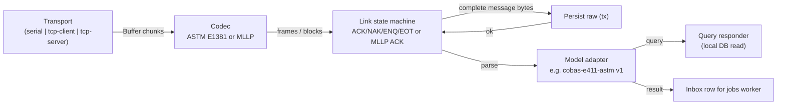

# 07. Analyzer Adapter Interfaces and HMIS API Contracts

## 1. Adapter architecture



Instruments without a model-specific driver use a generic, result-only
adapter (`generic-astm`, `generic-hl7-mllp`) on the same protocol cores,
configured by a profile. See [14](14-adding-instruments.md).

### 1.1 Interfaces (`packages/adapters`)

```ts
/** Byte-level transport. Knows nothing about protocols. */
export interface Transport {
  readonly kind: 'serial' | 'tcp-client' | 'tcp-server';
  open(signal: AbortSignal): Promise<void>;
  close(reason: string): Promise<void>;
  /** Resolves when the bytes are handed to the OS; rejects on error. Honors drain/backpressure. */
  write(bytes: Buffer): Promise<void>;
  /** Pause/resume reading (backpressure from the codec). */
  pause(): void;
  resume(): void;
  on(event: 'data', fn: (chunk: Buffer) => void): this;
  on(event: 'state', fn: (s: TransportState) => void): this;
}

/** Turns arbitrary chunks into protocol units. Pure; no I/O. */
export interface Codec<Unit> {
  /** May return 0..n units; keeps partial data internally. Throws BufferLimitError if limit exceeded. */
  push(chunk: Buffer): Unit[];
  reset(): void;
  readonly bufferedBytes: number;
}

/** Versioned, model-specific behaviour. */
export interface AnalyzerAdapter<Raw = unknown> {
  readonly name: string;                    // 'cobas-e411-astm'
  readonly version: string;                 // semver; recorded on every normalized message
  readonly optionsSchema: z.ZodTypeAny;     // validates adapterOptions
  readonly capabilities: AdapterCapabilities;
  createLink(ctx: LinkContext): LinkProtocol;           // ASTM or MLLP state machine
  parse(raw: Buffer, ctx: ParseContext): ParseResult<Raw>;
  normalize(parsed: Raw, ctx: NormalizeContext): NormalizedAnalyzerMessage;
  /** Build the instrument reply to a query from the middleware's view of the sample. */
  buildQueryResponse(q: QueryRequest, answer: QueryAnswer): Buffer;
}

export interface AdapterCapabilities {
  hostQuery: boolean;           // instrument asks for orders
  orderDownload: boolean;       // host may push orders unsolicited
  resultUpload: boolean;
  qcUpload: boolean;
  calibrationUpload: boolean;
  hostResultRequest: boolean;
  queryReplyDeadlineMs: number; // configured, from vendor doc, e.g. 15000 for e411 disk
}

export interface QueryAnswer {
  found: boolean;
  priority?: 'routine' | 'stat';
  tests: { instrumentTestCode: string; dilution?: string }[];
  patient?: { id?: string; name?: string; birthDate?: string; sex?: string }; // only fields the protocol carries
}

export interface LinkContext {
  instrumentId: InstrumentId;
  leaseEpoch: bigint;
  transport: Transport;
  /** Must durably store and resolve before the link sends a committing ACK. */
  persistInbound(bytes: Buffer, meta: InboundMeta): Promise<{ rawMessageId: string }>;
  persistFrame(frame: Buffer, meta: FrameMeta): Promise<void>;
  answerQuery(q: QueryRequest): Promise<QueryAnswer>;   // DB read only, with deadline
  nextOutbound(): Promise<OutboundMessage | null>;       // e411 batch download, if enabled
  log: Logger;
  clock: Clock;                                          // injectable for tests
}
```

Adapters are registered by `name@majorVersion`. A connection config pins the
adapter major version; upgrading an adapter major version is a configuration
change that is audited and re-verified.

### 1.2 Buffering, framing and backpressure

* Codecs keep a bounded `Buffer` list, never string concatenation. Data is
  only decoded to text once a complete frame/block is found.
* **Partial and multiple units per read** are the normal case: a TCP `data`
  event can contain half a frame, or a frame plus the next ENQ. The codec
  loop extracts every complete unit and keeps the rest.
* Limits (configurable): ASTM frame ≤ 247 bytes [DOC e411 HIM D-3] with an
  allowance (default 512) for line noise; ASTM message (all frame text of
  one transfer) and MLLP block ≤ `maxMessageBytes` of the connection
  (default 4 MB, Mindray `ED` fields can be large [DOC Mindray 6.2]).
* On limit breach: ASTM sends NAK and resets the frame; for a message past
  its limit it NAKs every further frame until the instrument gives up with
  EOT, then records the transfer as aborted (its frames stay stored, nothing
  is parsed). MLLP closes the connection (the only safe resynchronisation)
  and records an incident.
* Garbage before `STX`/`0x0B` is skipped and counted in a metric.
* Backpressure: the worker awaits the DB persist before ACKing; while a
  persist is in flight the codec calls `transport.pause()` once more than one
  unit is waiting. Over serial the instrument cannot send the next frame
  before our ACK anyway.

### 1.3 Character encoding

| Protocol | Decode | Notes |
|---|---|---|
| ASTM (e 411) | `latin1` for parsing; raw bytes stored | Alarm text not UTF-8 [DOC e411 HIM E-18]. 7-bit modes mask the top bit. |
| HL7 (Mindray) | UTF-8 with `fatal: true` | Invalid UTF-8 is quarantined, raw bytes stored [DOC Mindray §1] |

Escape sequences are decoded per protocol: ASTM `&F& &S& &R& &E&`
[DOC e411 HIM E-4]; HL7 `\F\ \S\ \T\ \R\ \E\ \.br\` [DOC Mindray §3].
Delimiters are read from the H record / MSH segment, never hard-coded.

## 2. cobas e 411 adapter (`cobas-e411-astm@1`), behaviour summary

Based on [DOC e411 HIM]; every item below is re-tested on site.

| Topic | Behaviour |
|---|---|
| Dialect | Option `protocolType: 'cobas' | 'elecsys'`; both parsers implemented; default per A-3 |
| Receive | ACK a frame only after `persistFrame` resolves. On EOT, assemble records, `persistInbound`, enqueue. |
| Checksum / FN | Verify; on mismatch send NAK. Duplicate FN (the analyzer re-sent after a lost ACK) is ACKed again but not appended twice. |
| Query | On `Q` with status `O`: look up barcode, reply `TSDWN^REPLY` echoing SequenceNo/Carrier/Position. Deadline budget: reply must start within 5 s (well under 15 s). If the lookup misses the budget, reply "no order" rather than say nothing, and flag the specimen. |
| Query cancel | `Q` status `A`: record cancel; if our reply is still pending, drop it. |
| Results | Parse O/R/C records; split `R-4` into value + message value / qualitative + COI; parse `<`/`>`; seven spaces = absent; R-9 `C` = rerun; C record alarm codes into `instrumentFlags`. |
| QC | Sample type `QC` (cobas®) / `CONTROL` (Elecsys®) or action code `Q`: `sampleClass = 'qc'`. |
| Read error | Sample ID starting `@` = `sampleIdReadError = true` → quarantine. |
| Generation | Map by host test code; store the raw application code for audit. |
| Batch download | Off by default. If enabled, warn in UI about the 2000-test overwrite [DOC e411 HIM F-9]. |
| Duplicate tests | Never send the same test twice in one O record [DOC e411 HIM E-13]. |
| Contention | If we sent ENQ and receive ENQ, yield: reply ACK and become receiver [DOC e411 HIM D-6]. |

## 3. cobas c 111 adapter (`cobas-c111-astm@1`), behaviour summary

Based on [DOC c111 HIM] (SW ≥ 3.0); installed version unconfirmed (B-9). It
reuses `protocol-astm` unchanged; only the record mapping differs from the
e 411.

| Topic | Behaviour |
|---|---|
| Link | Same E1381 state machine. Outbound split mode `record-per-frame` ("different records must be sent in different frames" [DOC 7.1.5]). Inbound: concatenate all frames until EOT, then split on CR [DOC 7.1.4.4]. |
| Flow control | Serial `flowControl: 'xonxoff'` if the analyzer keeps its default; with a device server, XON/XOFF is configured on the device server. Stray DC1/DC3 outside frames are logged as noise. |
| Instrument identity | Parse H-5 (`name^Roche^c111^<SW>^<protocol>^<serial>`) on every message; alert if SW version or serial differs from the verified values. |
| Query | `Q|1|^<SampleID>||ALL||||||||O`. Reply `TSDWN^REPLY` with O-3 = sample ID, O-5 `^^^<HostCode>^` repeated (max 60, no treatment by default), O-6 R/S, O-12 `A`, O-26 `O\Q`. No tests: O-5 empty, O-26 `Z` [DOC 7.2.2.5]. Reply budget 3 s (analyzer default timeout 10 s). |
| Rerun query | With "Send Order Query = ALWAYS" the analyzer asks again when a completed sample is reloaded [DOC 6.1.1.4]. Reply with rerun tests only if a technologist requested a rerun in the UI; otherwise "no tests". |
| Results | Sample ID from O-4 component 1 (O-3 is empty when sent by the analyzer). R-3 host code and treatment (D/C). R-4 numeric or `<`/`>` censored; no qualitative results. R-6 reference range. R-7 flags. C records: repeated `flag^comment` pairs into `instrumentFlags`. |
| Result status | `F` → initial, `C` → rerun (new version), `R` → **re-transmission** of an already-sent result (dedupe, no new version), `X` → not completed (quarantine as `INVALID_VALUE` with the C flags), `I` → QC ignored [DOC 7.2.2.7]. |
| QC | Action code `Q` or ID `1000 + control code` → `sampleClass = 'qc'`. |
| Calibration / raw data | M.CR / M.ICR → calibration store; M.RR → raw-data store linked to the result; never patient observations. |
| Result recovery | `RSREQ^REAL` with `Q|1|^<SampleID>||ALL||||||||F` for samples queried but not resulted after the expected time [DOC 6.4.1, 9.5]. Rate-limited (one request in flight per link). |
| Never sent | Database factory reset (EAC^U07) and reagent-disk commands: factory use only [DOC 6.4.1, 7.3]. The adapter has no code path that builds them. |

## 4. Mindray adapter (`mindray-hl7-mllp@1`), behaviour summary

Based on [DOC Mindray]; model applicability unconfirmed (B-3).

| Topic | Behaviour |
|---|---|
| Transport | `tcp-server` or `tcp-client` (B-4). One connection. Peer IP allow-list. |
| ORU^R01 | Persist, then reply `ACK^R01` with `MSA-1 = AA`, `MSA-2` = received `MSH-10`, `MSH-11` echoed (`P` or `Q`) [DOC Mindray 5.2, 5.4]. |
| Unparseable but framed | Persist; reply `AE` with MSA-6 code 100/101/102 per failure, **only if** testing shows the analyzer handles `AE` sensibly; otherwise `AA` + quarantine (option `ackOnStoreEvenIfInvalid`, default true). The ACK means "stored", not "clinically accepted". |
| ORM^O01 query | Sample ID from `ORC-3`; reply `ORR^O02` with `MSA|AA|<MSH-10>`, and on a hit PID/PV1/ORC (`AF`, ORC-2 = sample ID)/OBR (OBR-2 = sample ID)/OBX [DOC Mindray 5.5]. The "not found" reply format is unknown (B-5): until confirmed, reply MSH+MSA only and test it. |
| QC | `MSH-11 = Q` or `OBR-4 = 00003` → `sampleClass = 'qc'`; PID-3 = lot [DOC Mindray 4.3.3, 5.3]. |
| Observations | Key by `OBX-3.1` + `OBX-3.3`; ignore `OBX-3.2` for identity [DOC Mindray 4.3.6]. Flags split on `~`. `OBX-13` `E`/`e` → `editedOnInstrument`. `ED` values stored as blobs, not observations. RUO parameters `reportable = false` by default. |
| Placeholder values | Values like `***.**` appear in the doc's examples [DOC Mindray 5.1]; treat any non-numeric `NM` value as `absent`, keep original text. |
| Recheck | `01006` = `T` → result version kind `REPEAT`. |

## 5. Value parsing rules (shared)

| Input | Parsed as | Example |
|---|---|---|
| `0.310` | numeric `0.310`, scale 3 | e 411 R-4 |
| `<0.01`, `>1000`, `<=5` | censored, comparator + limit | e 411 range error [DOC E-16] |
| `-1^0.303` (qualitative test) | qualitative `-1` → mapped via `qualitativeMap` (e.g. "Non-reactive"), COI `0.303` kept as a secondary numeric | e 411 [DOC E-16, F-8] |
| 7 spaces / empty | absent `no-result` | e 411 [DOC E-16] |
| `***.*` | absent `masked` | Mindray examples |
| `1.25^` | numeric `1.25`, empty message value | e 411 cobas® example [DOC F-6] |
| `4.00-10.00` | reference range low/high | Mindray OBX-7 |
| `<10` in OBX-7 | reference upper limit | Mindray OBX-7 |

Unit conversion (only if the mapping says so) uses decimal arithmetic and the
mapping's declared scale. The original value and unit are always retained.

## 6. HMIS connector

### 6.1 Configurable connector

```ts
export interface HmisConnector {
  readonly profile: string;                          // 'generic-rest@1', 'fhir-r4@1' (only if HMIS supports it)
  pullOrders(cursor: string | null): Promise<{ orders: HmisOrder[]; nextCursor: string | null }>;
  acceptWebhook(req: RawHttpRequest): Promise<HmisOrderEvent[]>; // verifies signature
  acknowledgeOrder?(orderId: string, status: 'accepted' | 'rejected', reason?: string): Promise<void>;
  submitResult(r: HmisResultSubmission, idempotencyKey: string): Promise<SubmitOutcome>;
  findResult(lookup: { idempotencyKey: string; hmisOrderLineId: string }): Promise<HmisResultState | null>;
  cancelResult?(ref: HmisResultRef, reason: string): Promise<SubmitOutcome>;
}

export type SubmitOutcome =
  | { kind: 'accepted'; hmisResultId?: string }
  | { kind: 'retryable'; reason: string; retryAfterMs?: number }   // 429, 503, network before send
  | { kind: 'rejected'; reason: string }                          // 4xx validation: needs human
  | { kind: 'ambiguous'; reason: string };                        // timeout after send, 5xx after send, invalid body
```

Configuration (validated with Zod): base URL, auth type, token URL, scopes,
timeouts (connect 5 s, response 30 s defaults), rate limit (token bucket),
page size, retry policy, code maps, webhook secret reference.

**Authentication and rotation.** Credentials are read through a
`SecretProvider` at use time, not at start. OAuth tokens are cached until
`expires_in − 60 s`. A rotated client secret is picked up on the next token
refresh without restart. Two webhook secrets can be active during rotation.

Built so far: `fhir-r4@1` (§6.6) and a simulated HMIS for tests. Both
implement `pullOrders`, `submitResult` and `findResult`; there is no webhook
intake, order acknowledgement or result cancellation, because the HMIS
chose polling (D-3) and the proposal does not ask for the others.

### 6.2 Illustrative contracts

> **Illustrative only.** These show the shape the middleware needs. The real
> contracts come from the HMIS vendor's documentation (B-6). No endpoint
> below is known to exist.

Inbound order (canonical form after the HMIS profile maps it):

```json
{
  "hmisOrderId": "ORD-2026-000123",
  "patient": { "mrn": "MRN0001234", "familyName": "Example", "givenName": "Test", "birthDate": "1980-01-31", "sex": "F" },
  "encounter": { "hmisEncounterId": "ENC-889", "type": "outpatient", "location": "OPD-3" },
  "priority": "routine",
  "orderedAt": "2026-11-03T08:15:00+03:00",
  "orderingClinician": "Dr Example",
  "lines": [
    { "hmisLineId": "1", "testCode": "TSH", "specimenType": "SERUM" },
    { "hmisLineId": "2", "testCode": "FT4", "specimenType": "SERUM" },
    { "hmisLineId": "3", "testCode": "CBC", "specimenType": "EDTA_WB" }
  ],
  "status": "active"
}
```

Outbound result submission (canonical):

```json
{
  "idempotencyKey": "res:6f1c…:v2:release:1",
  "hmisOrderId": "ORD-2026-000123",
  "hmisLineId": "1",
  "testCode": "TSH",
  "status": "final",
  "value": { "type": "numeric", "value": "1.25", "unit": "µIU/mL" },
  "referenceRange": "0.27-4.20",
  "abnormalFlag": "N",
  "performedAt": "2026-11-03T10:16:04+03:00",
  "approvedBy": { "username": "jdoe", "displayName": "J. Doe" },
  "approvedAt": "2026-11-03T10:40:00+03:00",
  "specimen": { "accessionNo": "L26110300042", "collectedAt": "2026-11-03T08:40:00+03:00" },
  "instrument": "cobas e 411 (e411-01)",
  "comments": [],
  "correctionOf": null
}
```

Correction: same shape, `status: "corrected"`, `correctionOf` pointing to
the previously delivered idempotency key / HMIS result ID, plus `reason`.

### 6.3 Order intake

| Mode | Mechanism |
|---|---|
| Webhook | `POST /api/v1/hmis/webhooks/orders`. Verify signature/mTLS, validate, insert `inbox_message (source, externalId)` with unique constraint, return 2xx only after commit. Duplicate deliveries return 2xx without effect. |
| Polling | Jobs worker polls with a stored cursor (`hmis_cursor`). Page until done. Cursor advanced in the same transaction as the inbox inserts. Overlap window (e.g. re-read last 5 min) is safe because intake is idempotent. |

### 6.4 Mapping

* `hmis_code_map` per domain (test, specimen type, unit, sex, priority,
  status) with versioning and approval like instrument test mappings.
* Unknown HMIS test code: order is registered with the line flagged
  `UNMAPPED`, and the order appears on the "needs attention" list. It is not
  silently dropped.

### 6.5 Error classification for retries

| Condition | Class |
|---|---|
| DNS failure, connection refused, TLS handshake failure (request not sent) | retryable |
| 408, 425, 429 (respect `Retry-After`), 502, 503, 504 **before** body sent | retryable |
| Timeout after request body was sent; connection reset after send; 500; 2xx with invalid body | **ambiguous** → confirm via `findResult` before any retry |
| 400, 404 (order unknown), 409 (conflict), 422 | rejected → human |
| 401/403 | retryable once after token refresh, then alert |

### 6.6 FHIR R4 profile (`fhir-r4@1`)

Built to the lab's proposal to the in-house HMIS team (A-30; D-1 to D-6
answered 2026-11-04). Not tested against the HMIS: it has no test
environment yet.

* **Sign-in.** OAuth 2.0 client credentials at `LIMS_HMIS_TOKEN_URL` with
  HTTP Basic client authentication. The token is kept until 60 s before it
  expires. The secret is read at each token request, so a rotated secret
  needs no restart. A 401 gets one new token and one more try. A failure to
  get a token is retryable: nothing was sent.
* **Orders.** `GET {base}/ServiceRequest/_lab-feed?cursor=…&_count=N`
  (N = 100, 25 or 10). The jobs worker polls every
  `LIMS_HMIS_POLL_SECONDS` (30 s by default) and pages until an empty page.
  Each page and its cursor commit together (§6.3). Mapping: `requisition`
  (order system) → order; `identifier` (order-line system) → line;
  `code.coding` (test system) → HMIS test code, then `hmis_code_map`;
  the subject Patient's identifier (MRN system) → MRN; `authoredOn`,
  `priority` (asap counts as urgent), requester display, and the
  Encounter's identifier, class and first location. Status `revoked` or
  `entered-in-error` cancels the line.
* **Results.** `POST {base}` with a transaction Bundle holding a
  conditional `PUT Observation?identifier=<prefix>result|<line>` and
  `PUT DiagnosticReport?identifier=<prefix>report|<line>`. The Observation
  also carries `<prefix>submission|<idempotency key>`, the patient's MRN,
  `basedOn` the order line, the value with its decimal places kept
  (`5.40` stays `5.40`), the flag, the range, the accession number, the
  instrument, and report comments as notes. A correction updates the same
  two resources, with status `corrected` and the reason as a note.
* **Lookup.** `GET {base}/Observation?identifier=<prefix>submission|<key>`.
  If the HMIS cannot be asked, the delivery waits and asks again; it never
  resends without an answer.
* **Classification** follows §6.5, with two choices: 502, 503 and 504 are
  retryable whenever they come, because the conditional update makes a
  repeat harmless; and 2xx without a transaction response is ambiguous.
  `Retry-After` sets the next try, up to one hour.
* **Settings.** `LIMS_HMIS_PROFILE=fhir-r4`, `LIMS_HMIS_BASE_URL`,
  `LIMS_HMIS_TOKEN_URL` (both https), `LIMS_HMIS_CLIENT_ID`,
  `LIMS_HMIS_SCOPES`, `LIMS_HMIS_PAGE_SIZE`, `LIMS_HMIS_TIMEOUT_MS`
  (30 s), `LIMS_HMIS_POLL_SECONDS`, the four identifier systems
  `LIMS_HMIS_MRN_SYSTEM`, `LIMS_HMIS_ORDER_SYSTEM`,
  `LIMS_HMIS_ORDER_LINE_SYSTEM`, `LIMS_HMIS_TEST_SYSTEM`, and
  `LIMS_HMIS_LIMS_SYSTEM_PREFIX` (default `urn:lims-middleware:`). The
  client secret is the credential `hmis_client_secret` (11 §11).
* **Health.** Each poll's outcome is kept in `hmis_poll_status` (time,
  orders received, failures in a row, last error) and shown with the
  outbox on the HMIS link page (09 W-21), which also raises a dashboard
  warning.
* **Delivery worker.** A send left in progress by a stopped worker is
  picked up again when its two-minute lease runs out. A failed read-back
  after an accepted send leaves the result "sent".

## 7. Middleware REST API (OpenAPI)

Published at `/api/docs` (authenticated). Versioned under `/api/v1`. All
mutating endpoints require an `Idempotency-Key` header and a role.

| Method | Path | Role | Purpose |
|---|---|---|---|
| POST | `/api/v1/hmis/webhooks/orders` | HMIS client | Order events |
| GET | `/api/v1/orders/{id}` | technologist+ | Order detail |
| POST | `/api/v1/specimens/{id}/collect` | operator+ | Collection, prints label |
| POST | `/api/v1/specimens/{id}/receive` | operator+ | Receipt in lab |
| POST | `/api/v1/specimens/{id}/reject` | technologist+ | Reject with reason |
| GET | `/api/v1/results?status=received` | technologist+ | Review queue |
| POST | `/api/v1/results/{id}/review` | technologist | Review + choose version |
| POST | `/api/v1/results/{id}/approve` | approver | Approve + release |
| POST | `/api/v1/results/{id}/corrections` | approver | Correction with reason |
| POST | `/api/v1/outbox/{id}/replay` | administrator | Authorised replay |
| GET | `/api/v1/health/live`, `/api/v1/health/ready` | none (local) / monitor | Probes |
