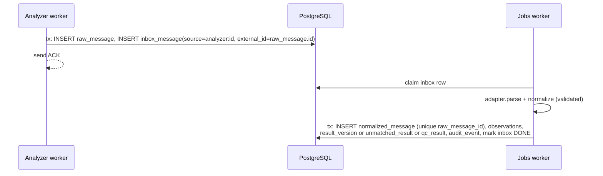

# 08. Durable Processing and Reconciliation

## 1. Guarantees

* **At-least-once processing with idempotent effects.** Every handler can run
  twice for the same message without creating a second clinical effect.
* **No end-to-end exactly-once promise.** In particular, if the HMIS accepts a
  result and the response is lost, we may send it again. Idempotency keys
  and confirmation reads make that safe where the HMIS supports them; where
  it does not, the case goes to a human (§7).
* **Transport acknowledgement, clinical approval, and HMIS delivery
  confirmation are three different facts**, stored in three different places:
  `raw_message.transport_ack`, `approval`, and `outbox_message` +
  `delivery_attempt` + `result.status = HMIS_CONFIRMED`.

## 2. Persist before acknowledge

| Source | What we store before ACK | ACK sent |
|---|---|---|
| e 411 frame | `raw_frame` row (bytes, FN, checksum result) | ASTM ACK for that frame |
| e 411 message (EOT) | `raw_message` + `inbox_message` in one transaction | none needed (EOT has no reply) |
| Mindray ORU | `raw_message` + `inbox_message` in one transaction | `ACK^R01` |
| Mindray ORM (query) | `raw_message` (query) | `ORR^O02` with the answer |
| HMIS webhook | `inbox_message` | HTTP 2xx |

If the insert fails (database down, disk full), the worker **does not ACK**.
For e 411 this means NAK or silence until the instrument's retries run out;
the lab re-sends later from the analyzer [DOC e411 HIM C-2]. The UI and
alerts tell the lab when that is needed.

Database durability settings: `synchronous_commit = on`, `fsync = on`
(defaults). These must not be relaxed for performance.

## 3. Queue tables and claiming

Three queues use the same pattern: `inbox_message`, `outbox_message`, and
`job` (scheduled maintenance tasks).

### 3.1 Claim

```sql
WITH next AS (
  SELECT id FROM outbox_message
  WHERE status = 'PENDING' AND available_at <= now()
    AND NOT EXISTS (                      -- per-key ordering: one in flight per result
      SELECT 1 FROM outbox_message o2
      WHERE o2.ordering_key = outbox_message.ordering_key
        AND o2.status = 'IN_PROGRESS')
  ORDER BY available_at
  FOR UPDATE SKIP LOCKED
  LIMIT $1
)
UPDATE outbox_message m
SET status = 'IN_PROGRESS', leased_by = $2, lease_until = now() + $3::interval, attempts = attempts + 1
FROM next WHERE m.id = next.id
RETURNING m.*;
```

* `SKIP LOCKED` lets several workers claim safely without blocking.
* The lease (`lease_until`, default 2 min) is extended by a heartbeat for
  long handlers.
* A **reaper** job returns `IN_PROGRESS` rows with expired leases to
  `PENDING` (inbox) or to the **confirm sweep** (outbox, since the HTTP call
  may have happened).
* Completion is a conditional update: `… WHERE id = $id AND leased_by = $me`.
  If zero rows update, the lease was lost and the result of this run is
  discarded (the effect itself was idempotent).

### 3.2 Retry scheduling

`delay = min(maxDelay, base × 2^(attempt−1)) × random(0.5, 1.0)` ("equal
jitter"). Defaults: base 5 s, max 15 min, max attempts 12 (≈ 2 to 3 hours),
then `DEAD`. HMIS `Retry-After` overrides when larger. All values are
configurable per topic.

### 3.3 Failed-message queue and replay

* `DEAD` rows appear on the **Failed transmissions** screen with the last
  error and all attempts.
* Replay requires the `administrator` role (or `approver` for result topics),
  a reason, and creates an audit event. Replay sets the row back to `PENDING`
  with `attempts` preserved and a `replayed_by` marker. The idempotency key
  is **unchanged**, so a replay cannot create a duplicate in a system that
  honours keys.
* Bulk replay is allowed for the same error class, with a confirmation step
  showing the count.

## 4. Inbox processing (analyzer results)



Because `normalized_message.raw_message_id` is unique, re-processing the same
raw message after a crash hits the constraint and the handler treats it as
"already done".

## 5. Duplicate detection that keeps legitimate repeats

A message can arrive twice because the instrument re-sent it (lost ACK,
operator pressed "send to host" again) or because a test was really run
twice. We separate these:

| Case | Signal | Treatment |
|---|---|---|
| Byte-identical re-send | Same `sha256` of the message body for the same instrument within a window (default 7 days) | Stored as raw (audit), marked `duplicate_of`, **no new result version** |
| Declared re-transmission | c 111 `R-9 = R` ("previously transmitted result") [DOC c111 HIM 7.2.2.7] | Linked to the existing observation; no new version. If the value differs from the stored one, raise an incident instead. |
| Same result re-sent in batch | Same instrument, sample ID, test code, completion timestamp (e 411 R-13 / Mindray OBR-7), value text, dilution | No new version; linked to the existing observation |
| Rerun / repeat | e 411 or c 111 `R-9 = C`; Mindray recheck flag; or a different completion timestamp | **New version**, kind `REPEAT` |
| Dilution | Different dilution component (e 411 R-3) | New version, kind `DILUTION` |
| Operator-edited on instrument | Mindray `OBX-13` `E`/`e` | New version, flagged `edited on instrument` |

The dedupe key is computed by the adapter (`dedupeKey()`), versioned with the
adapter, and stored on `observation`. A unique index on
`(result_id, dedupe_key)` makes double insertion impossible.

## 6. Outbox (HMIS delivery)

1. Approver approves. In **one transaction**: insert `approval`, insert
   `release`, insert `outbox_message` with
   `idempotency_key = res:<resultId>:v<versionNo>:release:<releaseNo>`,
   update `result.status = QUEUED`, insert audit event.
2. Jobs worker claims the row and calls `submitResult(payload, key)`.
3. Outcome handling:

| Outcome | Action |
|---|---|
| accepted | `DONE`, `result.status = SENT`, store HMIS result ID |
| retryable | back to `PENDING` with backoff |
| rejected | `DEAD`, `result.status = FAILED`, alert, shows on Failed transmissions |
| ambiguous | `FAILED` with outcome `AMBIGUOUS` → confirm sweep (§7) |

4. A **confirmation sweep** (every 5 min) reads back `SENT` results from the
   HMIS (`findResult`) and moves them to `HMIS_CONFIRMED` when value, status,
   and version match. Mismatches raise an incident. If the HMIS has no
   read-back API, `SENT` is the final automated state and the UI says so
   honestly ("sent, not confirmed").

Corrections and cancellations use their own topics with the same ordering
key (the result ID), so a correction can never overtake the original.

## 7. Request succeeded but response was lost

Order of preference, depending on what the HMIS supports (D-5, D-7):

1. **HMIS honours an idempotency key**: retry with the same key; HMIS
   returns the original outcome.
2. **HMIS supports lookup by our key or by order line**: the confirm sweep
   queries before retrying. Found and matching → `DONE`. Not found after a
   grace period (default 2 min, to cover slow commits) → retry.
3. **Neither**: do **not** retry automatically. Create a reconciliation case;
   a user checks the HMIS and marks "delivered" or "not delivered" (audited).

## 8. Outage behaviour

| Outage | Analyzer links | Results | HMIS orders | Recovery |
|---|---|---|---|---|
| HMIS down | Unaffected | Approved results queue in outbox | Downtime registration available | Outbox drains with rate limit; poller catches up from cursor |
| Network to device server | Link drops; reconnect with backoff 1 s to 60 s | Instrument retries then errors; lab re-sends | Unaffected | Alarm after 2 min down |
| Analyzer off | As above | n/a | n/a | n/a |
| PostgreSQL down | Workers stop ACKing; links stay open but NAK/withhold ACK; readiness = false | Nothing lost that was ACKed | Webhooks return 503 (HMIS should retry; confirm D-3) | Processes reconnect with backoff; no restart needed |
| Disk full | DB writes fail → same as DB down | | | Disk alarm fires earlier (§10) |
| Web process down | Unaffected | Unaffected | Webhooks fail (HMIS retries) | Service manager restarts |
| Jobs process down | Unaffected | Inbox and outbox accumulate | Polling paused | Restart; work resumes from queue |
| Analyzer worker crash | That link drops; service manager restarts in ~5 s; lease reclaimed after expiry or immediately by same host identity | Instrument retries the unACKed frame/message | n/a | Partial ASTM sessions are discarded and logged |

## 9. Safe shutdown and restart

On `SIGTERM` / Windows service stop:

1. Stop claiming new queue rows; mark readiness false.
2. **Analyzer worker**: finish the current frame/message persist and ACK if
   already in progress; do not start a new establishment phase; then send
   EOT if we were sender; close the transport; release the lease
   (`lease_until = now()`).
3. **Jobs worker**: wait up to 20 s for in-flight handlers; anything still
   running keeps its lease and is recovered by the reaper after expiry.
4. **Web**: stop accepting connections, finish in-flight requests (10 s).
5. Flush logs; exit 0.

Service wrappers are configured with a stop timeout of 30 s before kill.

## 10. Monitoring for durability

| Check | Warning | Critical |
|---|---|---|
| Oldest `PENDING` inbox age | 2 min | 10 min |
| Oldest `PENDING` outbox age | 15 min | 60 min |
| `DEAD` rows | ≥ 1 | ≥ 10 |
| Ambiguous deliveries unresolved | ≥ 1 for 30 min | ≥ 1 for 4 h |
| Unmatched results open | ≥ 1 for 1 h | ≥ 1 for 8 h |
| Analyzer link down (enabled instrument) | 2 min | 15 min |
| Disk free (DB, logs, archive volumes) | < 25 % | < 10 % |
| DB connection failures | any in 5 min | sustained 2 min |
| Event-loop delay p99 | > 100 ms | > 500 ms |
| Lease renewal failures | 1 | 3 consecutive |

Alerts go to the integration health screen and, where available, to the
hospital's email/SMS gateway or monitoring system.

## 11. Reconciliation jobs

| Job | Frequency | Does |
|---|---|---|
| Delivery confirmation sweep | 5 min | `SENT` → `HMIS_CONFIRMED` or incident |
| Ambiguous delivery resolver | 5 min | §7 |
| HMIS order catch-up | per polling interval | Reads cursor; idempotent upsert |
| HMIS cancellation check | 15 min | For open orders, compare HMIS status; flag cancellations after collection for the lab |
| Loaded-not-resulted | 30 min | Specimens on instruments past expected TAT |
| c 111 result recovery | 15 min | For c 111 samples queried but without results past expected TAT, send `RSREQ` (one at a time); the c 111 does not re-send unconfirmed results by itself [DOC c111 HIM 6.5] |
| Unmatched results ageing | hourly | Escalation per §10 |
| Downtime reconciliation | on HMIS recovery | Builds match proposals for provisional patients/orders |
| Retention / archival | nightly | §3.4 of [06](06-database-and-state-machines.md); every purge is audited |
| Audit chain verification | nightly | Recomputes hash chain, exports signed digest ([10](10-security-and-audit.md)) |

## 12. Quarantine, approval, autoverification, critical results

* **Quarantine** (`unmatched_result`) reasons: `UNKNOWN_BARCODE`,
  `READ_ERROR_PLACEHOLDER`, `UNMAPPED_TEST`, `NOT_ORDERED`, `CANCELLED_TEST`,
  `REJECTED_SPECIMEN`, `INVALID_VALUE`, `ENCODING_ERROR`,
  `DEMOGRAPHIC_MISMATCH`. Resolution actions: link to specimen (with reason,
  second-person check configurable), discard (with reason), or keep for
  investigation. All audited.
* **Human approval by default.** Release without approval is blocked in
  service code **and** by a database trigger (06 §3.1).
* **Autoverification** is a per-test rule set (range limits, delta check,
  no instrument flags, not edited on instrument, not a repeat, QC status
  acceptable). It is **disabled** unless the lab director enables it for a
  specific test with a reference to the validation report. Every decision is
  stored (`autoverification_decision`) with the rule-set version.

  **Built** (A-19): approvers keep rules at **Autoverification**
  (`autoverify_rule`: test, inclusive low and high, units, validation report,
  QC confirmation; at most one active rule per test, enforced by a partial
  unique index; a change retires the old rule and adds a new one; both
  audited and step-up confirmed). The first instrument value of a new result
  for a test with a rule is checked inside the intake transaction, and the
  decision is stored (`autoverification_decision`, append-only, every check
  with its detail and the rule id). A pass sets the result to `approved` by
  `system:autoverify` with an `approve` event, so the outbox trigger accepts
  the later release; release is still done by a person. Repeats,
  dilutions, corrections and manual values are never autoverified. A rule
  can also require QC in range for the test on that instrument within a
  number of hours (A-21). The result page shows the decision and any failed checks.

  **Delta check, built** (A-20): approvers keep rules at **Autoverification →
  Delta checks** (`delta_rule`, one active per test, audited and step-up
  confirmed). Each numeric version is compared, as it is written, with the
  patient's last approved result for the test inside the rule's window, and
  keeps the outcome (`result_version.delta_flag`, `delta_detail`,
  `delta_previous_result_id`). Reviewers see the change, the previous value
  and a link to it; the results list shows a badge. A flag does not block
  approval; autoverification holds it.

  **QC log, built** (A-21): QC observations, already kept apart from patient
  results (T-16), are each checked at intake against the lab's ranges
  (`qc_range`, one active per instrument, test and control; audited and
  step-up confirmed) and the outcome is kept (`qc_evaluation`,
  append-only). The **QC** page lists recent results and every control whose
  latest result failed; the dashboard warns until a later result passes.
  **Westgard rules, built** (A-23): a range may carry the control's target
  mean and SD and the lab's choice of 1-2s (warning), 1-3s, 2-2s, 4-1s and
  10x, checked along that control's earlier accepted results, and R-4s,
  checked against the test's other controls within a run window the lab
  sets (A-38); a rejection
  inside the range is `RULE_VIOLATION`. The z score and the rules broken are
  kept on `qc_evaluation`. Each range has a Levey-Jennings chart (W-15).
* **Critical results**: a configurable critical range per test and patient
  group. When a version crosses it: flag in review, require the approver to
  record the communication (who was told, when, read-back confirmed), and
  show unacknowledged criticals on a dashboard with an escalation timer.
  Critical notification does not depend on HMIS availability.

  **Built** (A-18): approvers keep limits at **Critical → Critical limits**
  (`critical_limit`: test, sex, age band, low and/or high, units, and the
  lab document the values come from; never edited, a change retires the old
  limit and adds a new one; both audited). Each result version is checked
  once, as it is written (instrument value, repeat, dilution, or
  correction), and keeps its flag (`result_version.critical_flag`: `LOW`,
  `HIGH`, `ANSWER` for a catalogue answer the lab marked critical (A-36), or
  `UNITS_DIFFER` when the units do not match the limit, which a person must
  compare by hand). A `LOW`, `HIGH` or `ANSWER` version cannot be approved
  or released until someone records the call (`critical_call`, append-only:
  who was told, their role and ward, when, read back; a call without
  read-back cannot be saved). The dashboard and the **Critical** page list
  every critical version without a call, oldest first, with the time
  waiting and, once the lab has set one, the call target and how far past
  it each call is (A-37), and refresh every minute. A critical version replaced before
  approval by a later selected one (a repeat that came back normal) drops
  off the list; one arriving after approval stays. Sending SMS or e-mail
  waits for the hospital gateway (13, phase 5).
