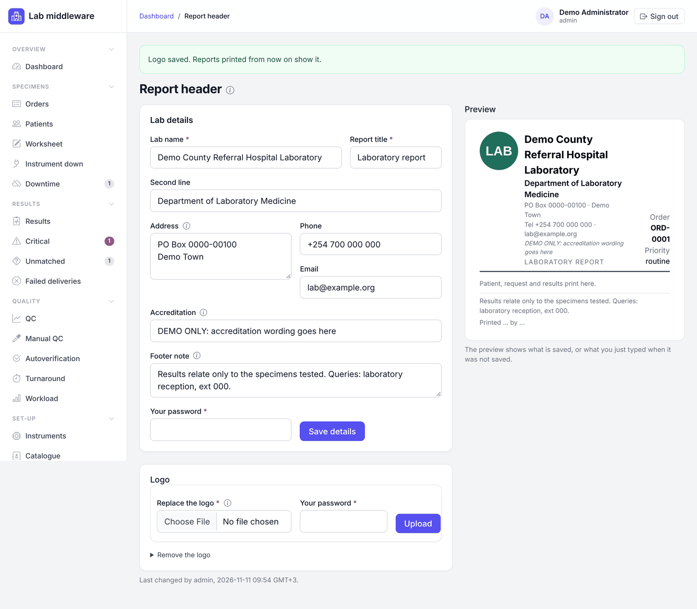

# Admin

[← User manual](README.md)

The admin role keeps the system running: user accounts, the report
letterhead, instruments and their connections, and resending failed
messages. It does **not** include clinical decisions. An admin cannot
review, approve or release results unless also given the approver role.

Every account change asks for **your own password** again and is recorded in
the audit trail.

## User accounts

**Administration → Users** lists every account with its roles, how it signs
in (*hospital sign-in* or *local password*) and its state (*active*,
*disabled*, *locked*, *temporary password*).

### Roles

| Role | Give it to |
|---|---|
| `operator` | Reception and phlebotomy: collect, label, receive, downtime registration |
| `technologist` | Bench staff: results entry, review, critical calls, send-outs, instrument settings |
| `approver` | Senior staff and the lab director: approve, release, correct, clinical settings |
| `admin` | System administrators: users, report header, instruments, failed messages |
| `auditor` | Quality manager and auditors: read everything, audit trail, exports |

Give each person only the roles their job needs. See the
[table of tasks by role](README.md#what-each-role-can-do).

### Create a local account

1. Click **New user**.
2. Enter the **Username**, **Display name**, a **Temporary password** (at
   least 12 characters) and tick the roles.
3. Enter your password and click **Create user**.
4. Give the temporary password to the person in private. They must choose
   their own at first sign-in.

### Change an account

Open the account from the list. The page shows when it was created, when the
password last changed, its open sessions and its **Account history**. Each
change needs your password:

* **Save roles**: tick the roles and save. At least one role is needed; to
  stop someone signing in, disable the account instead.
* **Disable account** (with a reason) ends every session at once. The
  account and its history are kept. **Enable account** reverses it.
* **Set a temporary password** ends their sessions; they must choose their
  own at next sign-in.
* **Unlock now** clears a lock after five wrong passwords, instead of waiting
  15 minutes.

Safety rules the middleware enforces:

* You cannot change **your own** roles or state:
  another admin must. You can change your own password on **Change
  password**.
* The **last active admin** cannot lose the admin role or be disabled.

### Hospital sign-in accounts

If the lab uses the hospital sign-in (single sign-on or the directory), an
account is created automatically the first time a person signs in. Its
roles follow the person's **directory groups** at every sign-in, so you
cannot change them here; change the person's groups, or ask IT to change the
role map in the settings (`LIMS_OIDC_ROLE_MAP` or `LIMS_LDAP_ROLE_MAP`).
Someone with no mapped group cannot sign in. You can still **disable** such
an account here. Passwords are changed with the hospital.

Keep at least one local admin account for emergency access when the
directory is down, and keep its password sealed.

## Report header

**Set-up → Report header** (admins only) sets what prints at the top and foot
of every lab report.

1. Under **Lab details**, fill in the **Lab name** and **Report title**
   (required), a **Second line** (such as the department), **Address** (up
   to 4 lines, printed as typed), **Phone**, **Email**, **Accreditation**
   (printed exactly as typed; only put what the lab holds now) and a
   **Footer note** printed at the foot of every report.
2. Enter your password and click **Save details**.
3. Then, under **Logo**, choose a PNG or JPEG file, enter your password and
   click **Upload**. It prints up to 2 cm high; a square or wide image with a
   white or clear background prints best. **Remove the logo** takes it off.

The **Preview** on the right shows the letterhead as it will print. Every
change is in the audit log with what it was before. Reports already printed
keep what was on them. Until the details are saved, reports print the
heading from the server setting.

## Instruments

Admins share instrument set-up with technologists. See
[Technologist: instruments](technologist.md#instruments-with-admins) for
registering an instrument, its connection settings and drafting test
mappings. Admins can also:

* **Record interface test** results from the vendor's engineer;
* **Suspend** an instrument or **Start verification again** (each with a
  reason), for example after a service visit or a software change;
* **Turn off** an instrument's link.

**Signing lab acceptance**, **turning an instrument on** and **approving
test mappings** are approver steps (the lab director). See
[Approver: clear an instrument for clinical use](approver.md#clear-an-instrument-for-clinical-use).

The instrument page also shows the **Active connection** settings and keeps
earlier configurations, so older messages are decoded with the settings
they arrived under.

## Test catalogue and referral labs

Admins can propose and approve catalogue changes and keep the referral lab
list, like approvers. A catalogue change is approved by a different person
from the one who proposed it. See [Approver: test catalogue](approver.md#test-catalogue)
and [Approver: referral labs](approver.md#referral-labs).

## Patient merges

Admins can record and confirm patient merges with a second person. See
[Approver: patient merges](approver.md#patient-merges).

## The HMIS link and failed deliveries

**Set-up → HMIS link** shows the order feed (last poll that worked, failures
in a row, last error) and the released results on their way, with every
delivery attempt. It refreshes every minute. The dashboard shows an amber
banner when the link has trouble.

**Results → Failed deliveries** lists results the HMIS refused or that could
not be delivered after every try. When the cause is fixed, open the result,
give a **Reason for sending again** and click **Send again**.

If the page says no order poll has been recorded, the HMIS connection is not
configured yet; until then orders are registered in downtime mode. Server
settings, installation, backups and upgrades are in the
[installation and runbooks](../design/11-installation-and-runbooks.md).
