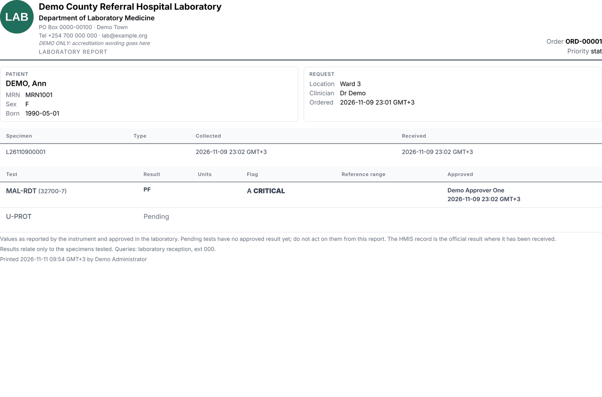
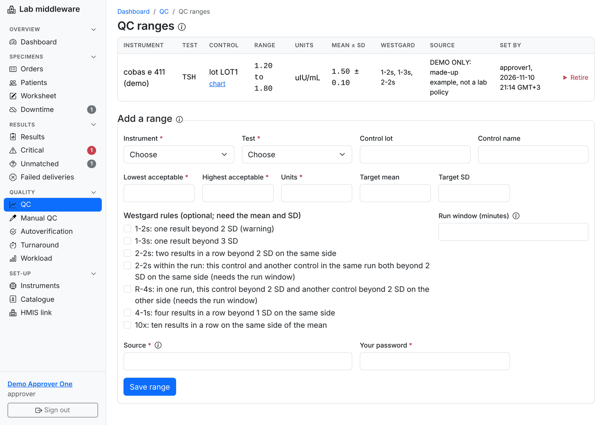
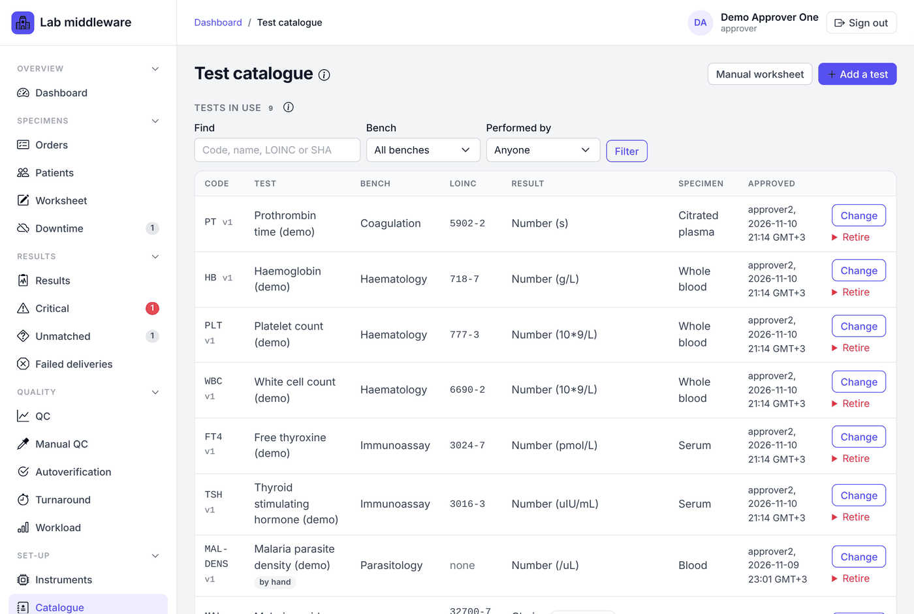
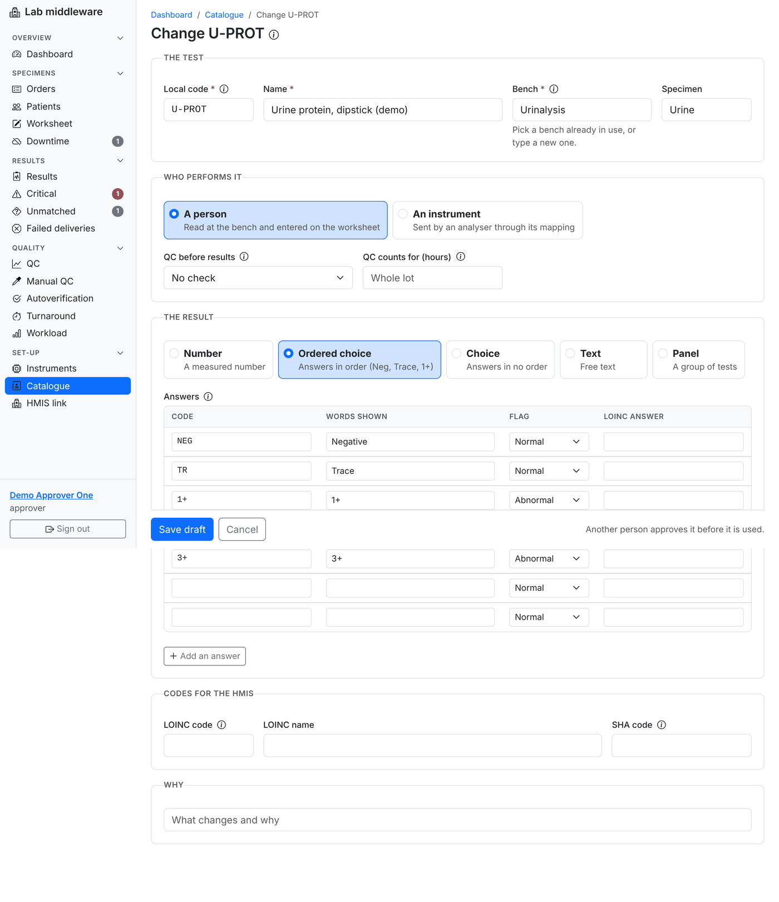
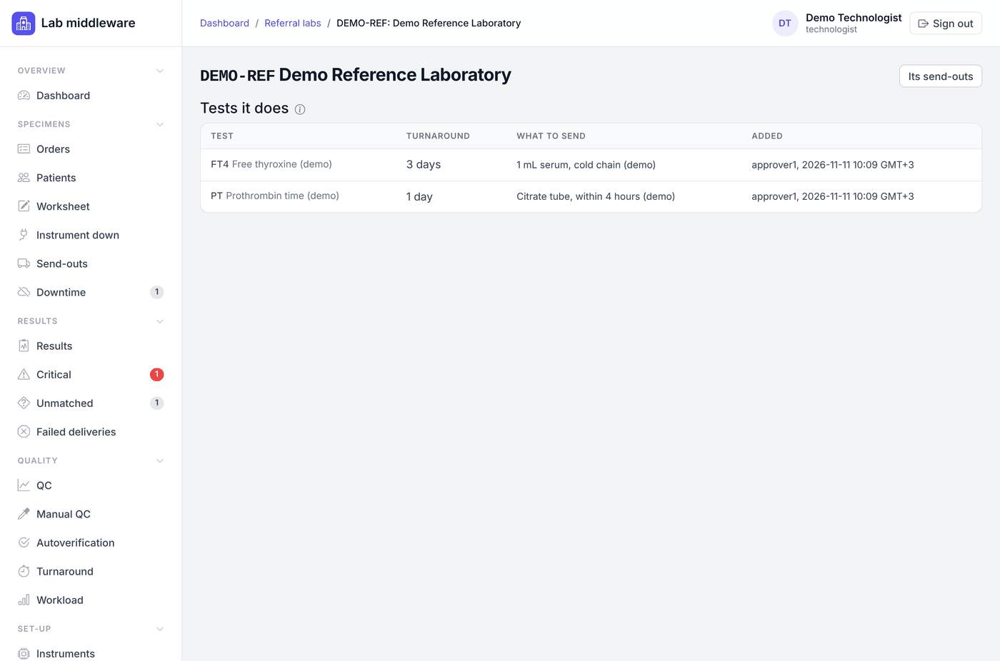
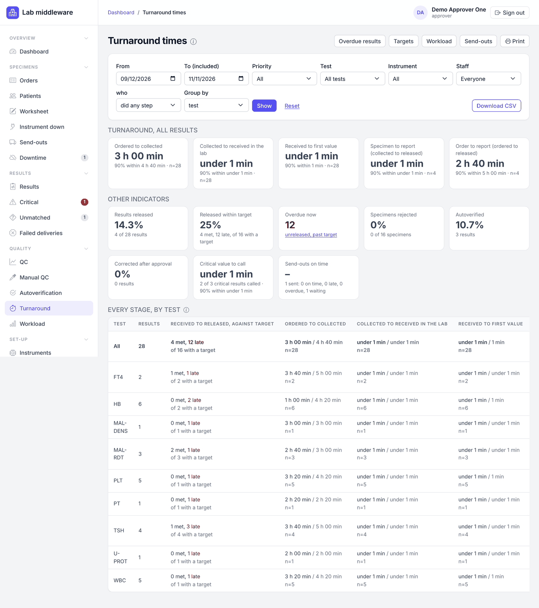

# Approver

[← User manual](README.md)

Approvers (senior technologists, section heads and the lab director) make
the final decision on each result and send it to the HMIS. They also keep
the lab's clinical settings: QC ranges, critical limits, reference ranges,
delta checks, autoverification, standard comments, turnaround targets and
the test catalogue. Approvers can do everything in the
[Operator](operator.md) and [Technologist](technologist.md) chapters.

Most steps in this chapter ask for **your password** (or a fresh hospital
sign-in) and are recorded in the audit trail with your name.

## Approve a result

1. Open **Results**, button **To approve** (or the dashboard tile).
2. Open a result and check it as a reviewer would: value, flags, versions,
   delta, QC, critical call, comments.
3. Enter your password and click **Approve**.

The middleware refuses to approve when:

* the result has not been reviewed (use **Mark reviewed** first; with the
  two-person rule on, someone else must have reviewed it);
* **you reviewed it** and the two-person rule is on;
* **you performed** the manual test, or **you typed it in** from an
  instrument printout or a referral lab's report: another person checks it
  against the paper;
* it is critical and **no call has been recorded**.

## Release to the HMIS

An approved result waits under **Approved, not released** until a person
releases it. On the result, enter your password and click **Release to
HMIS**. The result moves to **Waiting to send**, then **Sent, awaiting
HMIS**, then **Confirmed by HMIS** when the HMIS accepts it.

The release button does not appear when the result is held:

* the instrument is **not cleared for clinical use**;
* it belongs to a **downtime order** that is not reconciled;
* it is a **test added by the lab** that is not yet matched to an HMIS line.

Results approved by an **autoverification** rule show the badge
*autoverified* and still wait for a person to release them.

## Comments on the printed report

As an approver you can tick **Print it on the result report under the
value** when adding a comment. Only an approver can withdraw a comment that
is on the report.

## Correct a released result

When a result already sent to the HMIS was wrong:

1. Open the result. Under **Corrected value**, type the right value and units.
2. Give a **Reason** (at least 10 characters), enter your password and click
   **Save correction**.

The correction is a new version, approved by you; the earlier value stays in
the history and the order report marks the value *(corrected)*. The result
goes back to **Approved, not released**: click **Release to HMIS** to send
the correction to the HMIS as a corrected result.

If a new value arrives from the instrument after approval, the
result page warns you so you can decide whether a correction is needed.

## Failed deliveries

**Results → Failed deliveries** lists results the HMIS refused or that could
not be delivered after every try, and the outgoing messages behind them.
Find out why (the **Last error** column, the **HMIS link** page, hospital
IT), then open the result, give a **Reason for sending again** and click
**Send again**. Admins can do this too.

## Printed result reports

**Print result report** on an order (or **Print results** on a patient's
page, or **Order report** on a result) opens the lab report for the whole
order, with the lab's letterhead. Only approved results carry a value, with
units, flags, the reference range, and who approved it and when; the others
print as *Pending* or *Cancelled*. Critical values print as **CRITICAL** and
report comments print under the value. The footer says who printed it and
when. The letterhead is set by an admin under
[Report header](admin.md#report-header).

## The lab's clinical settings

The middleware ships with **no** limits, ranges, rules or targets: every
value is entered by the lab, from its own documents, and each needs a
**Source** (the lab policy, insert or validation report, with its version).
To change one, add the new one and retire the old one; both stay in the
history, and results already made are not changed.

### QC ranges and Westgard rules

**Quality → QC → QC ranges**. For each instrument, test and control: the
lowest and highest acceptable value, units, and optionally the target mean
and SD with the Westgard rules the lab's QC plan uses. Name the control
exactly as the instrument sends it (lot, name or both). R-4s and 2-2s within
the run also need a **Run window** in minutes. A 1-2s result is only a
warning; any other broken rule marks the QC as failed. A range applies to
QC results that arrive after it is saved. For a new control lot, add its
range and retire the old one.

Each range has a **chart** (Levey-Jennings). **QC summary** gives, per
control and period, n, mean, SD, CV, bias and shift for the monthly QC
review; approvers and auditors can **Download CSV**.

### Critical limits and call targets

**Results → Critical → Critical limits and call targets**. A result is
critical below the low limit or above the high limit (the limit itself is
not critical). A limit can apply to everyone or one sex and an age band.
When a patient's sex or age is unknown, every limit for the test applies.
Units must match exactly; when they differ the result is marked for a person
to compare.

**Call target times** set how soon a critical result must be phoned, for
every test or for one test.

### Reference ranges

**Results → Reference ranges**. The lab's own ranges, by sex and age band,
shown on result pages and the printed report with a mark when a value is
outside. A range applies only when it certainly fits the patient. The mark
is for people reading the result; it is not sent to the HMIS and
autoverification does not use it.

### Delta checks

**Autoverification → Delta checks**. Compares a new value with the patient's
most recent approved result for the same test within a number of days, and
flags a change larger than the rule allows (in units, in percent, or both).
A delta flag does not block approval, but autoverification leaves a flagged
value for a person.

### Autoverification

**Quality → Autoverification**. With a rule, the first value of a new result
for that test is approved without a person when every check passes: a plain
number in the rule's units and range, no abnormal or instrument flags, not
edited, not critical, no delta flag, QC in range if the rule asks, and an
instrument cleared for clinical use. Any failed check leaves the result for
a person; the result page lists every check. Release is still done by a
person.

Add a rule **only after the lab's own validation of it**, give the
validation report as the source, and confirm the lab's QC procedure covers
the test. **Turn off** a rule with a reason. The page shows how many results
each rule autoverified in the last 7 days.

### Standard comments

**Results → Standard comments**. Comments the lab uses often, for every test
or one test, ready to pick on a result page. Picking one copies its text, so
rewording or retiring it later never changes a comment already made.

### Turnaround targets

**Turnaround → Targets**. The lab's target time from receipt in the lab to
release, in minutes. The most specific target applies: test and priority,
then test, then priority, then one for every test. Targets apply to the
turnaround report and the overdue list as soon as they are saved, including
earlier results.

## Test catalogue

**Set-up → Catalogue** is the lab's list of tests. Approvers and admins
propose changes; **a different person** approves them.

* **Add a test** or **Change** an existing one. Fill in the local code,
  name, bench, specimen, who performs it (instrument or by hand), the unit
  and decimals or the list of answers (mark answers *abnormal* or
  *critical*), panel components, the **LOINC code** the HMIS orders by, and
  why. For tests read by a person, choose whether results need a passing
  QC control first (block or warn) and for how many hours a control counts.
* **Save draft**. The draft appears under **Waiting for approval**.
* Another approver or admin checks it, enters their password and clicks
  **Approve**, or **Discard**s it.
* **Retire** a test, with a reason, when the lab stops doing it.

Results already made keep the catalogue version they were made with. A
malaria smear and a malaria rapid test have different LOINC codes; pick the
code for this method and specimen.

## Referral labs

**Set-up → Referral labs** (approvers and admins). Add each outside lab with
its code, name and contact details, then on its page add the **tests it
does** with the agreed **turnaround** in hours (from dispatch here to their
result report) and what to send. To change a turnaround, retire the line and
add it again; send-outs already made keep their turnaround. Untick **In use**
to stop new send-outs to a lab.

## Patient merges

When medical records merge two MRNs in the HMIS, record it here so a
patient's history includes both (approvers and admins, two people).

1. Open the patient whose MRN goes away, and open **Record a merge from the
   HMIS**.
2. Enter the **MRN that stays**, the HMIS or medical records reference, and
   why. Click **Propose merge**.
3. A different person opens the same patient, compares the two records side
   by side (differences are highlighted), enters their password and clicks
   **Confirm merge**.

Orders and results keep the MRN they came with; the remaining patient's
page shows the full history. A merge recorded in error, or reversed in the
HMIS, is undone the same way: **Undo this merge**, then a second person
confirms.

## Clear an instrument for clinical use

An instrument's results can be released only once it is **lab accepted**
and turned on. The instrument page shows its verification state and what is
missing.

1. **Record interface test** (approver or admin): who tested it, their
   organisation, the date, the signed test record reference and the
   software version tested.
2. **Sign lab acceptance** (approver, as the lab director): the parallel-run
   report reference and your password. You sign as yourself.
3. **Turn on** (approver) with a reason.
4. **Approve and make active** the test mapping draft, after checking the
   differences. You cannot approve a draft you saved yourself.

**Suspend** (with a reason of at least 10 characters) stops release at once,
for example after a service visit or a software update. **Start
verification again** returns it to unverified. **Turn off** stops the link.
Every step is in the instrument's **Verification history**.

## Turnaround and lab indicators

**Quality → Turnaround** shows how long each stage takes, for specimens
collected on the chosen days. Everyone can read it; approvers and auditors
can **Download CSV**.

* **Filters**: From and To days, **Priority**, **Test**, **Instrument** (or
  manual entry), **Staff** and the **Part they played** (collected, received,
  entered the result, approved, released). **Group by** test, instrument,
  priority, day collected, or who did each step.
* **Turnaround tiles**: ordered to collected, collected to received,
  received to first value, and the totals *specimen to report* and *order to
  report*. Each shows the median, the 90th percentile ("90% within") and how
  many results it counts.
* **Other indicators**: results released, released within target, overdue
  now, specimens rejected (with reasons), autoverified, corrected after
  approval, critical value to call, and send-outs on time.
* **Every stage** table: each stage for every group, with the result against
  the target when targets are set.

Each stage uses the first time it happened, so a correction or resend does
not move it. A stage whose times run backwards (for example a collection
time typed in after receipt) is left out and counted. Test, instrument and
staff filters apply to the result figures; specimen, rejection,
critical-call and send-out figures follow the days and priority only.
**Print** gives a paper copy for the quality meeting.

**Overdue results** lists unreleased results past their target, most late
first. **Workload** counts what each instrument measured, repeats and QC by
instrument, test and day.
