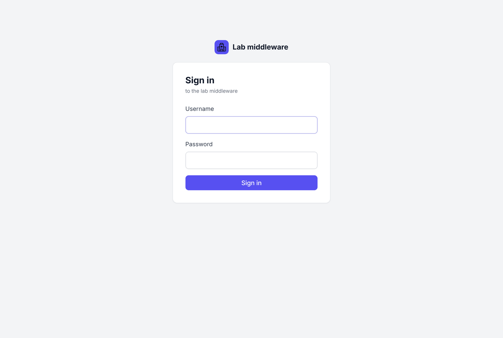
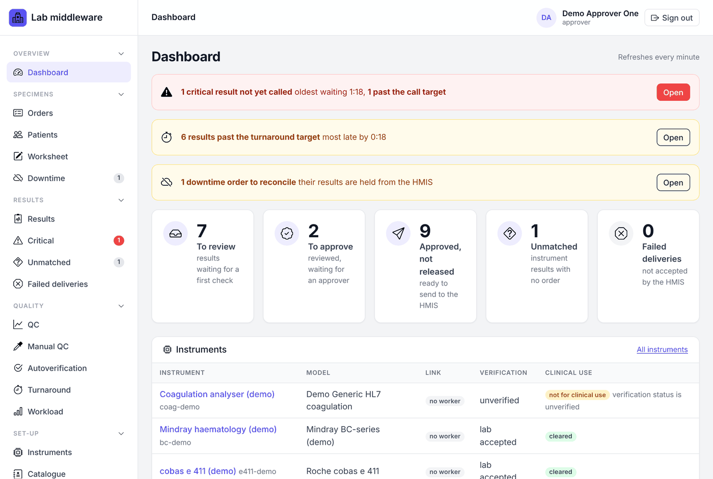

# Getting started (all roles)

[← User manual](README.md)

## Signing in

Open the middleware's address in the browser (hospital IT gives you the
address). The middleware runs inside the hospital network only.

There are three ways to sign in, depending on how your lab is set up:

* **Hospital sign-in (single sign-on).** If the page shows a button such as
  *Sign in with your hospital account*, use it. You sign in at the hospital's
  sign-in page with your usual hospital username and password. Your roles
  come from your hospital directory groups; ask IT to change the group if
  your roles are wrong.
* **Directory username and password.** If the page says *Sign in with your …
  username and password*, type your usual hospital username and password into
  the form. Roles come from directory groups, as above.
* **Local account.** Type the username and password the administrator gave
  you. Local accounts are mainly for emergency access when the hospital
  directory is down.

After five wrong passwords a local account is locked for 15 minutes. An
administrator can unlock it sooner.

### Your first sign-in with a temporary password

If an administrator created your account or reset your password, you are
taken straight to **Change password** and cannot open any other page until
you choose your own. Type the temporary password, then your new password
twice (at least 12 characters). Your other sessions end; this one stays
signed in. You can change your password at any time from the same page.
Hospital sign-in accounts change their password with the hospital, not here.

### Sessions

You are signed out after **15 minutes without activity**, and after **12
hours** in any case. Use **Sign out** at the top right when you leave a
shared computer. If a form says *The form has expired*, go back, reload the
page and try again.

## Confirming important actions with your password

Steps that matter clinically, such as approving or releasing a result,
confirming a link made by someone else, reconciling a downtime order, or
changing a limit or range, ask for **Your password** in the form. This is a
fresh check that you are the person at the keyboard; it is recorded in the
audit trail with your name.

If you sign in through the hospital sign-in, those forms instead show a link
**Confirm with the hospital sign-in**. Follow it, sign in again at the
hospital page, and you come back to the same form. The confirmation then
covers **one** action within 5 minutes.

## Finding your way around

The **menu** on the left groups the pages by the lab's work:

| Group | Pages |
|---|---|
| Overview | Dashboard |
| Specimens | Orders, Patients, Worksheet, Instrument down, Send-outs, Downtime |
| Results | Results, Critical, Unmatched, Failed deliveries |
| Quality | QC, Manual QC, Autoverification, Turnaround, Workload |
| Set-up | Instruments, Catalogue, HMIS link, Referral labs, Report header (admin) |
| Administration | Audit (auditor), Users (admin) |

A number beside a menu link is work waiting there; red numbers (Critical,
Failed deliveries) are urgent. Click a group heading to fold it away; the
browser remembers this. On a phone the menu opens from the **Menu** button.

The top bar shows where you are (a breadcrumb trail you can click back
through), your name and roles, and **Sign out**.

### The dashboard

The dashboard refreshes every minute. At the top, coloured banners appear
only when something needs attention:

* **Red:** critical results not yet phoned, how long the oldest has waited,
  and how many are past the call target.
* **Amber:** the HMIS link is having trouble, a QC control has failed,
  results are past the turnaround target, or downtime orders are waiting to
  be reconciled.

When none of these apply, a grey line says so. Below are tiles for **To
review**, **To approve**, **Approved, not released**, **Unmatched** and
**Failed deliveries**, each opening the matching list, and a table of the
instruments with their link state, verification and whether they are
cleared for clinical use.

### Lists, search and paging

Most lists have a search box at the top. Orders search by accession, MRN,
name or HMIS order number; Results also by test code. Long lists are split
into pages with links at the bottom. On the Results page the coloured
buttons (*To review*, *To approve* and so on) filter by state and show how
many results are in each.

### Times

All times are shown in the lab's time zone, which is set by IT. When you type
a time, such as a collection time, it is read in the same time zone.

### Printing

Pages meant for paper, such as the order report, a patient's page, labels
and the turnaround report, have a **Print** button. Menus and buttons are
left off the printout. You can also use Ctrl+P.

### Messages

* A green line at the top of the page confirms what you just did.
* A red box headed **Not saved** lists what was wrong with a form; nothing
  was saved, and what you typed is kept so you can fix it.
* *Your account does not have permission for this* means the step belongs to
  a different role.
* *Someone else changed this result while you were looking at it* means two
  people worked on the same result at once. Reload the page and check before
  trying again.

See [Reference](reference.md#common-messages) for more.
