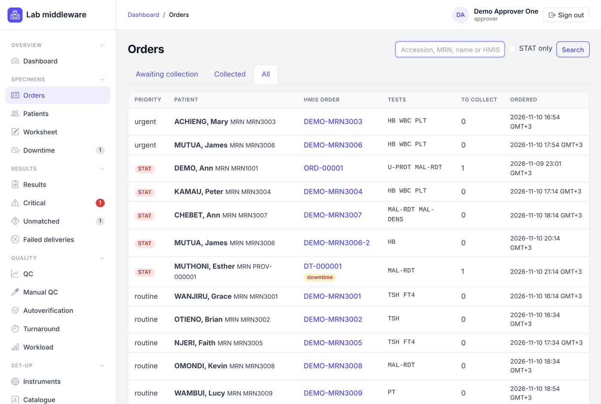
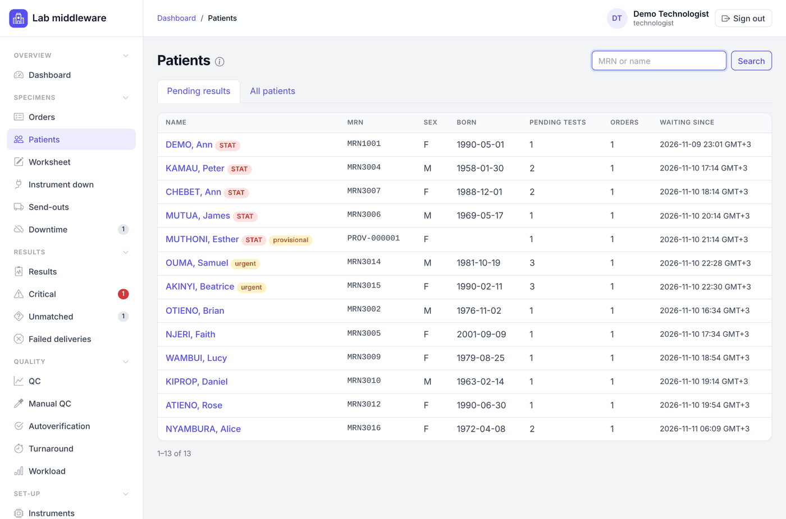
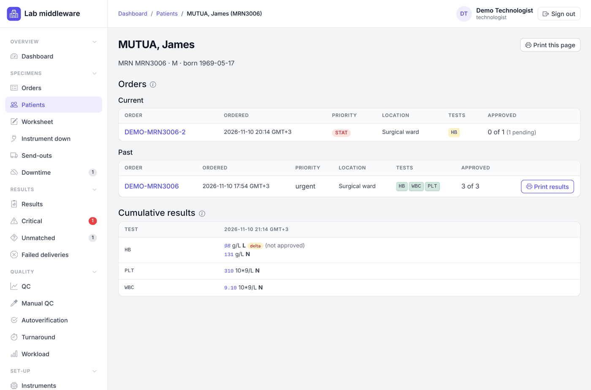
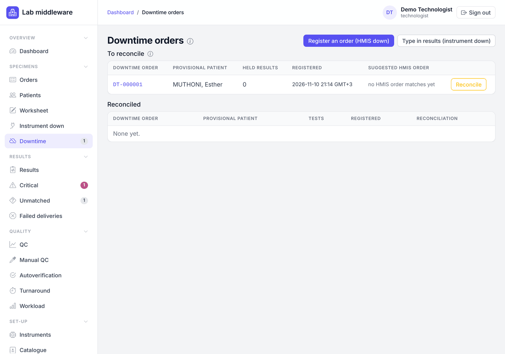

# Operator

[← User manual](README.md)

Operators collect and label specimens, receive them in the lab, and register
orders by hand when the HMIS is down. Technologists and approvers can do all
of this too.

## Orders

Orders come from the HMIS automatically: the middleware checks the HMIS for
new orders every few moments while the HMIS link is working. You never type in an order
that is in the HMIS.

Open **Specimens → Orders**. The tabs show orders **Awaiting collection**,
**Collected** and **All**. Search by accession number, MRN, patient name or
HMIS order number, and tick **STAT only** to see urgent orders. STAT orders
carry a red **STAT** badge. The *To collect* column shows how many tests
still need a specimen.

Click the HMIS order number to open the order. The order page shows the
patient (click the name for the patient's page), where and when it was
ordered and by whom, the tests still to collect, the specimens already
taken, and **Print result report**.

## Collect a specimen and print its label

1. Open the order. Under **To collect**, the tests are grouped by specimen
   type, one card per container.
2. Leave ticked the tests going into this container. Untick any you are not
   collecting now; they stay on the list. A test marked **not mapped** has no
   instrument mapping yet; tell a technologist.
3. **Collected at** is filled with the current time. Change it only if the
   specimen was drawn earlier.
4. Click **Collect and print label**. The middleware gives the specimen an
   accession number and opens its label.
5. Print the label on the label printer (Ctrl+P) and put it on the tube.

Tests that need different specimen types cannot go in one container; collect
each card separately.

If the label did not print or was damaged, open the label again from the
order page (**label** link beside the specimen) and click **Record a reprint**
before printing, so the number of labels printed stays correct.

## Receive a specimen in the lab

When the tube arrives in the lab, open its order (search by accession or
scan the barcode into the Orders search box) and click **Receive** beside the
specimen. The receipt time starts the lab's turnaround clock. Only collected
specimens can be received.

Click the accession number to see the specimen's page: its tests and their
results, and its full history (collected, labels printed, received,
rejected).

## Patients

**Specimens → Patients** lists patients.

* **Pending results** lists patients with a test on an open order that has no
  approved result yet, STAT first, then whoever has waited longest. Use it to
  answer "is my patient's result ready?".
* **All patients** lists everyone the middleware knows, by family name.

Search by MRN or name; an exact MRN opens that patient straight away.

A patient's page shows all their orders (**Current** orders still have a test
without an approved result; **Past** orders are complete), and a table of
**Cumulative results** with the newest collection first. Values in italics
are not yet approved.

To give a patient or ward a copy of results, click **Print results** beside
the order. This opens the order's lab report, ready to print. Only approved
results carry a value on it; the rest print as *Pending*. **Print this page**
at the top prints the patient's whole page.

A badge **provisional** means the patient was registered by hand during HMIS
downtime and has not yet been reconciled. **reconciled** means that record
has been joined to the HMIS patient.

## When the HMIS is down: register a downtime order

Use this **only** when the HMIS cannot be reached and a specimen must be
processed.

1. Open **Specimens → Downtime** and click **Register an order (HMIS down)**.
2. Fill in the patient from the request form: family name (required), given
   name, birth date, sex, the **MRN on the request form** if there is one,
   ward or clinic, requesting clinician and specimen type.
3. Choose **Routine** or **STAT**, tick the tests, and click **Register
   downtime order**.
4. The order opens with a downtime number. Collect and label the specimen as
   usual.

The patient and order are **provisional**. Results can be reviewed and
approved, but they are **held from the HMIS** until a technologist or
approver reconciles the order to the real HMIS order once the HMIS is back
(see [Technologist: reconcile downtime orders](technologist.md#reconcile-downtime-orders)).
The dashboard shows how many downtime orders are waiting.

The MRN you type is only used later to find the matching HMIS order; it is
not checked now, so copy it carefully.
