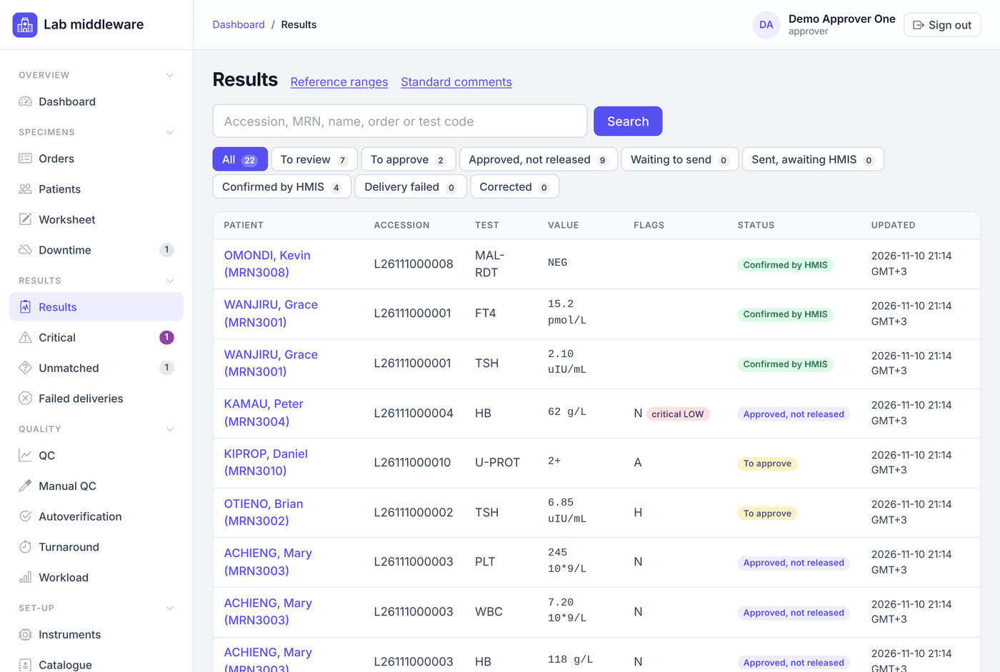
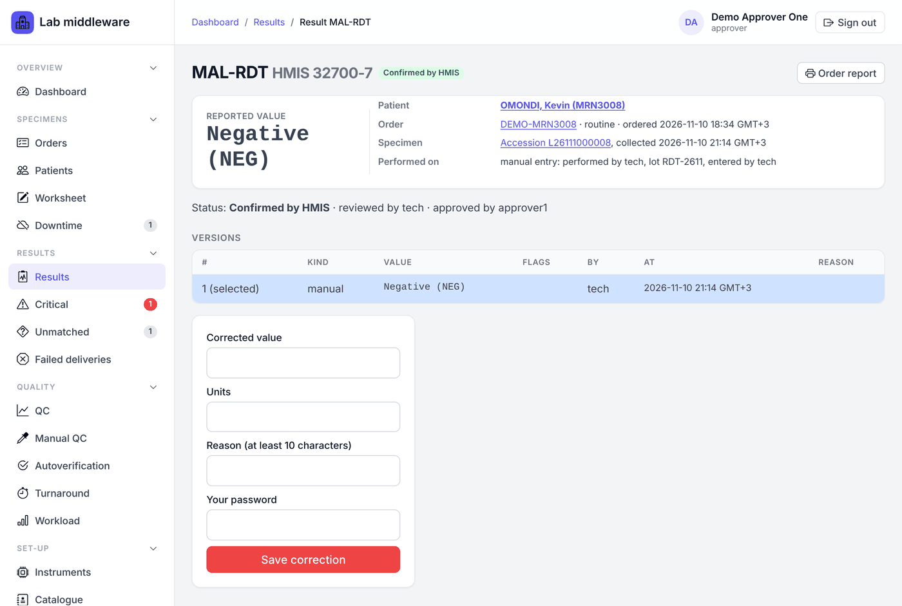
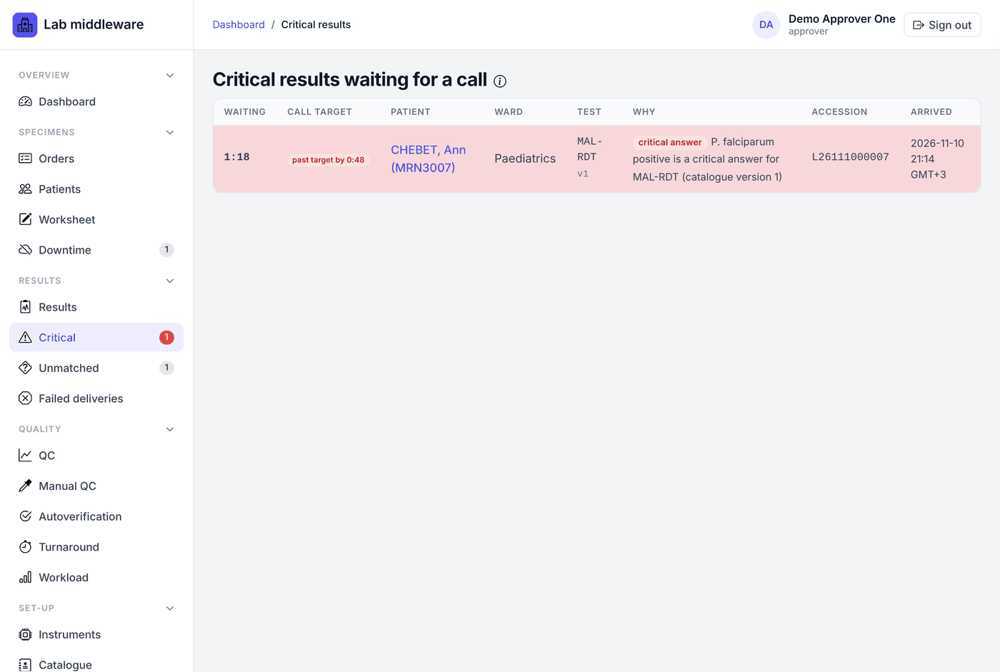
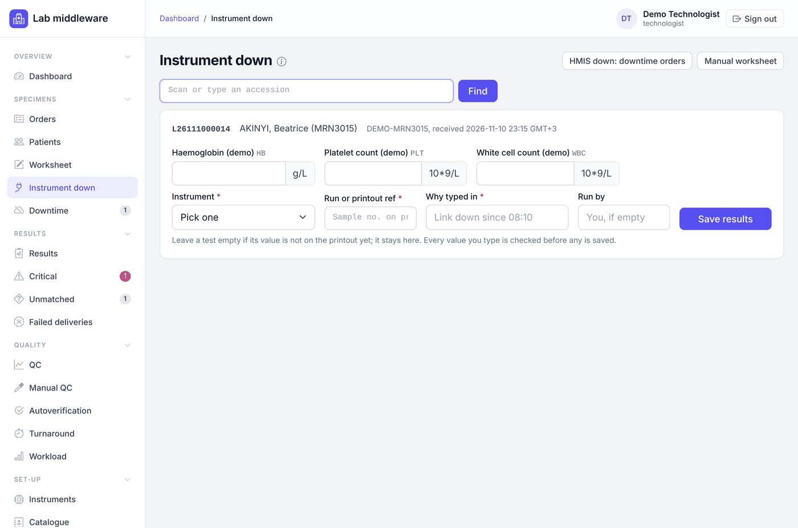
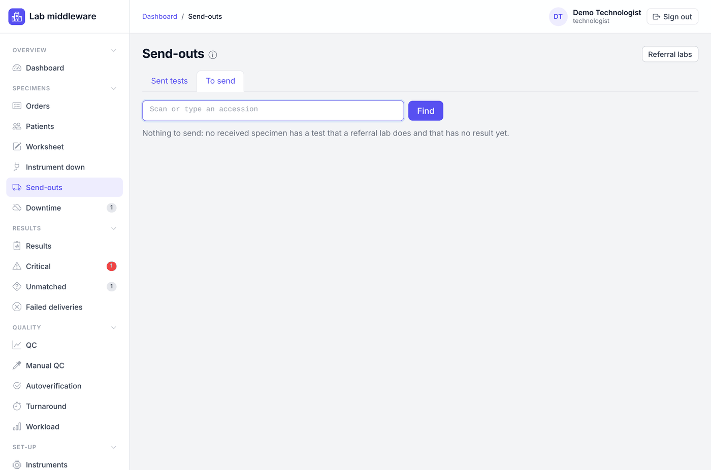
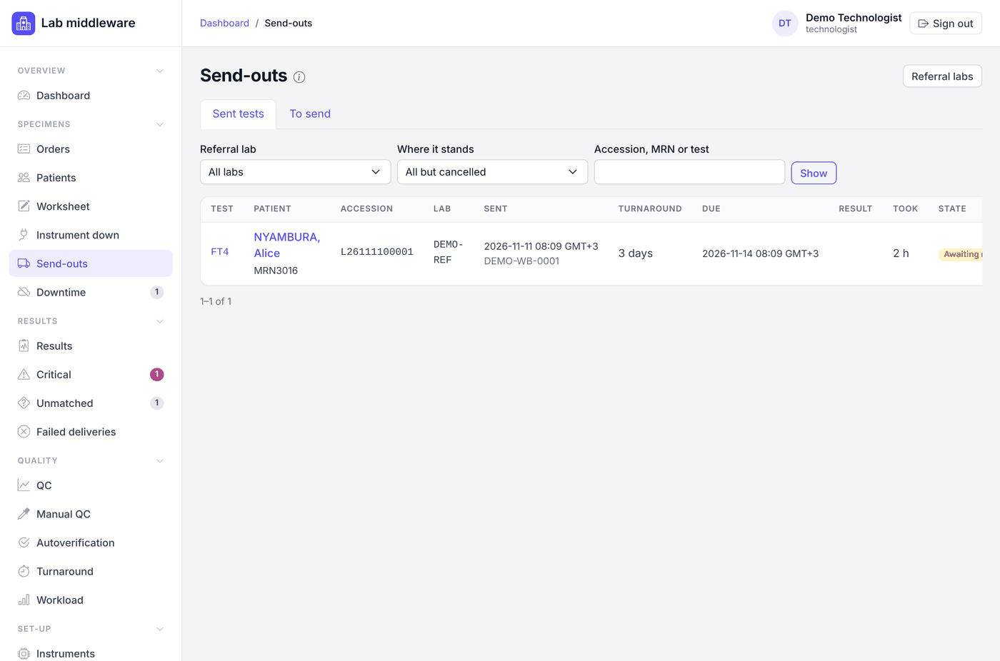
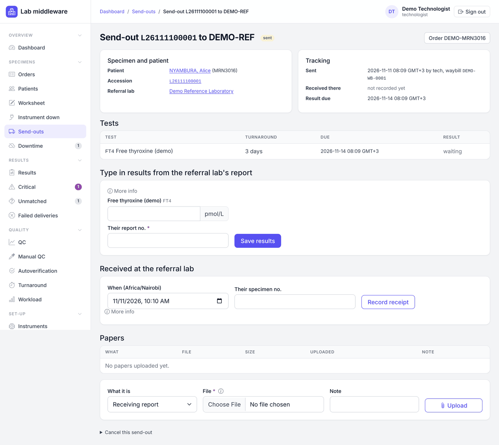
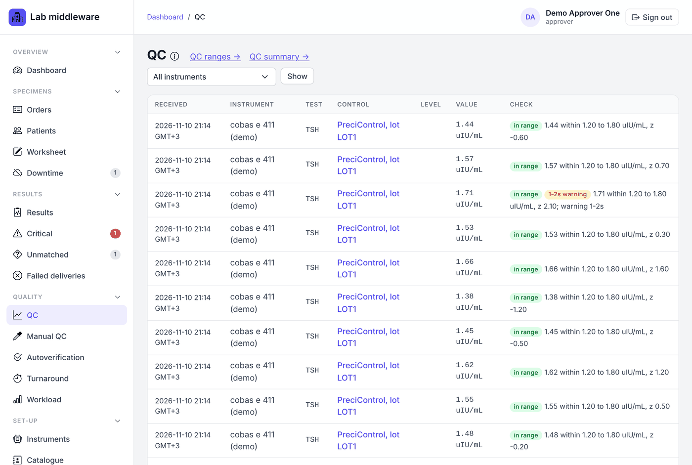

# Technologist

[← User manual](README.md)

Technologists run the tests, enter results that do not come from a connected
instrument, give every result its first check, phone critical results, and
handle the specimens that go wrong. Everything in the
[Operator](operator.md) chapter (collecting, labelling, receiving, downtime
registration) is open to you too. Approvers can do everything in this
chapter.

Some steps here need **a second person**: you propose, a colleague confirms.
The middleware will not let the same person do both. See
[Reference: steps that need a second person](reference.md#steps-that-need-a-second-person).

## How a result moves through the lab

```
arrives (instrument, worksheet, typed in)
   → To review → Mark reviewed (technologist or approver)
   → To approve → Approve (approver)
   → Approved, not released → Release to HMIS (approver)
   → Waiting to send → Sent, awaiting HMIS → Confirmed by HMIS
```

A critical result must have its phone call recorded before it can be
approved. Results from an instrument not cleared for clinical use, from a
downtime order, or from a test added by the lab can be reviewed and approved
but are **held** from the HMIS until the problem is cleared.

## Results list



**Results → Results** lists every result. The buttons above the table filter
by state (**To review**, **To approve**, **Approved, not released** and so
on) and show how many are in each. Search by accession, MRN, name, order or
test code. The **Flags** column shows instrument flags, a red **critical**
badge, and an amber **delta** badge when the value changed more than the
lab's delta rule allows. **needs attention** marks a result that has
something to sort out, such as a new value after approval.

The Results page also links to the lab's **Reference ranges** and
**Standard comments**.

## Review a result



Open a result from the list. The page shows:

* the **reported value**, its flags, and the reference range (the lab's own
  range if one fits the patient, otherwise the range the instrument sent);
* the patient, order and specimen, each a link;
* **Performed on**: the instrument, or *manual entry* with who performed it
  and the kit lot, or *typed in from the printout*, or the referral lab;
* warnings in coloured boxes (not for clinical use, downtime order, added by
  the lab, new value after approval);
* every **version** of the value (repeats, dilutions, corrections), with a
  delta note linking to the previous result when there is one;
* the **autoverification** checks, if a rule ran;
* **critical calls**, **comments** and the **history** of every decision.

To review:

1. Check the value against the specimen, the instrument flags, QC and the
   patient's previous results (the patient link shows cumulative results).
2. If there are several versions (for example a repeat), choose the one to
   report under **Version to report**.
3. Click **Mark reviewed**. The result moves to **To approve**.

With the two-person rule on (the usual setting), the approver must be a
different person from the reviewer.

### Comments

Under **Comments**, pick a **Standard comment** or type one and click **Add
comment**. Comments you add are for the lab only. Only an approver can put
a comment on the printed report. To take a comment back, open **Withdraw**
beside it and give a reason; it stays visible, struck through, with your
reason.

## Phone a critical result



A result is **critical** when it crosses one of the lab's critical limits or
is an answer the catalogue marks as critical. Critical results appear on
**Results → Critical**, in red on the dashboard, and with a red count in the
menu. The list shows how long each has waited and whether it is past the
lab's call target. Phone the oldest first.

1. Open the result from the Critical list.
2. Phone the ward or clinician. Ask them to **read the patient's name and
   the value back** to you.
3. In **Record the call**, choose the version, enter **Person told**, **Their
   role and ward**, and how many minutes ago you told them (0 if just now).
   Add a note if useful, such as earlier attempts.
4. Tick **They read the patient's name and the value back to me correctly**
   and click **Record the call**.

The result cannot be approved or released until the call is recorded. Nothing
escalates automatically; the list and dashboard keep showing calls past the
target.

## Enter manual results: the worksheet

**Specimens → Worksheet** lists received specimens waiting for tests read by
a person (malaria smears and rapid tests, urinalysis, microscopy and so on),
STAT first then oldest first. Choose a **Bench** to see only your bench.

1. For each card, pick or type the result. Nothing is filled in for you:
   pick every answer, including a negative.
2. For a panel (several tests on one card), fill the ones you have read;
   leave the others empty and they stay on the worksheet.
3. **Performed by** is you if left empty; type the name if someone else read
   it. Enter the **Kit or strip lot**.
4. Click **Save result**.

The card shows the test's QC state: which lots have a passing control now.
Depending on the catalogue, a result without a passing control on its lot is
either **refused** or saved and marked *QC missing for the lot*. A saved result goes
through review and approval like any other. The person who performed a
manual test cannot approve it.

### Record a manual QC control

**Quality → Manual QC** records controls for tests read by a person: positive
and negative controls on a new rapid-test kit lot, a known slide for a stain
batch, a control strip for a dipstick lot.

1. Choose the **Test** and click **Record a control**.
2. Enter the **lot** (and its expiry), the **Control** (for example *positive
   control*), what it **Should read** and what you **Read**. For coded tests
   the middleware decides pass or fail; otherwise choose **Passed** or
   **Failed**.
3. Click **Record control**.

Record every run, including failed ones. A failed control stays in force
until the same control passes again on the same lot. The top of the page
lists the lots that may be used now.

## Type in results when an instrument link is down



When an analyser still measures but its link to the middleware is down, use
**Specimens → Instrument down**.

1. Scan or type the accession and click **Find** (or work down the list).
2. Type each value exactly as on the printout or screen. Leave empty any
   value not on the printout yet; it stays waiting.
3. Choose the **Instrument**, enter the **Run or printout ref** (the sample
   or run number on the printout), **Why typed in** (for example *Link down
   since 08:10*) and **Run by**.
4. Click **Save results**. Every value is checked before any is saved.

These results are marked *typed in from the printout*. Someone other than
the person who typed them must approve them, checking each value against the
printout. Keep the printout.

## Reject a specimen

On the order page, under the specimen, open **Reject …**:

1. Choose the **Reason** (haemolysed, clotted, insufficient volume, wrong
   container, unlabelled or mislabelled, transport delay or wrong
   temperature, other).
2. Describe **What was wrong** (at least 5 characters).
3. Leave **Recollect** ticked to put the tests without a result back on the
   collection list.
4. Click **Reject specimen**.

Rejections are counted on the turnaround report.

## Unmatched results

**Results → Unmatched** lists instrument results that could not be attached
to an order, for example an unreadable barcode or a sample ID with no order.
They are never guessed onto a patient.

Open **Resolve** on a row:

* **Link to a specimen.** Scan the right tube's accession, explain why it
  belongs there (at least 10 characters) and click **Propose link**. It links
  only to the same test on that specimen. A **different person** then opens
  it, checks the specimen and patient, enters their password and clicks
  **Confirm link**.
* **Add the test to the order.** When a clinician phoned to ask for a test on
  a specimen already in the lab, before the HMIS has the order line: enter
  the accession, who asked, and how the request came, then **Propose added
  test**. A different person confirms. See *Tests added by the lab* below.
* **Close without linking**, with a reason, when the result should not be
  used (for example a test run).

If the instrument code has no active mapping, the result cannot be linked
until the mapping is fixed. Either person can **Withdraw proposal**.

### Tests added by the lab

A result for an added test can be reviewed and approved, but is held from
the HMIS until the clinician orders the test in the HMIS. When that order
line arrives, open the order: under **Tests added by the lab**, choose the
**HMIS line**, enter your password and click **Match**. Until then the row
shows **waiting for the HMIS line**.

## Send tests to a referral lab

Tests the lab does not do in house are sent to referral labs. Each referral
lab has a list of tests it does with an agreed turnaround, kept by approvers
and admins on **Set-up → Referral labs**.

### Record a package as sent



1. Open **Specimens → Send-outs**, tab **To send**. It lists received
   specimens with tests a referral lab does and no result yet, STAT first. To
   send a test the lab usually does in house, scan its accession.
2. On the specimen's card, pick the **Referral lab**, tick the tests going in
   this package, set **Sent at** and the **Courier or waybill no.**
3. Click **Record as sent**.

A test can only go to a lab that has it on its list, so every send-out has a
due time.

### Follow up and enter the results



The **Sent tests** tab lists every test sent out, overdue first, with when it
was sent, its turnaround, when it is due, and how long it took. Filter by lab,
by **Where it stands** (overdue, awaiting result, resulted late or on time,
cancelled) or search by accession, MRN or test. Call the referral lab about
any overdue test.



Open a send-out to work on it:

* **Received at the referral lab**: enter when they received it and their
  specimen number, from their receiving report, a call or their portal, and
  click **Record receipt**.
* **Papers**: upload the receiving report, the result report or other papers
  (PDF, PNG or JPEG, up to 5 MB). Download them from the same table.
* **Type in results from the referral lab's report**: copy each value exactly
  as on their report, enter **Their report no.** and click **Save results**.
  Leave a test empty if it is not on this report. Upload the report as well.
  Someone other than the person who typed the values approves them.
* **Cancel this send-out**, with a reason, only before any result is typed
  in (for example the specimen leaked). Its tests go back to **To send**.

## Reconcile downtime orders

When the HMIS is back, every order registered during downtime must be joined
to the real HMIS order before its results can be released.

1. Open **Specimens → Downtime**. **To reconcile** lists the downtime orders,
   those with approved results waiting first, with the best matching HMIS
   order. **clear** means it matches on the MRN written on the form, or on
   birth date and family name, has every test, and nothing else comes close.
   **check** means look carefully. **not ordered** means the HMIS order lacks
   a test.
2. Click **Reconcile**. Compare the provisional patient with each possible
   HMIS order.
3. On the right one, enter your password and click **Same patient:
   reconcile**. Or type the **HMIS order number** at the bottom.

Specimens and results move to the HMIS order; accession numbers and labels
stay the same. This cannot be undone from the screen, so check the patient
carefully. If no HMIS order matches yet, it appears once the HMIS sends it.

## Instruments (with admins)

Technologists and admins can register instruments and edit their settings
and test mappings. Approving mappings and clearing an instrument for
clinical use are approver steps.

* **Register an instrument**: **Set-up → Instruments → Register instrument**.
  Fill in the identity from the instrument and its inventory record (ID,
  name, manufacturer, model, serial, software version, location, interface
  manual), the driver, and the connection (tcp-client, tcp-server or serial,
  with the addresses or port settings). Use a generic profile only when no
  model-specific driver exists; generic profiles receive results only. A new
  instrument starts **unverified** and **turned off**.
* **Change registration**: from the instrument's page.
* **Test mappings** link each instrument test code to a test in the lab's
  catalogue. Use **Edit mappings row by row**, or load the reviewed mapping
  file as a draft. Saving makes a draft; the page shows its differences from
  the active set. A **different person** with the approver role approves it.
  Until a mapping set is active, every result from that instrument goes to
  the unmatched list. Research-use-only parameters are never reported.

## Quality pages you can read

All of these are open to read; approvers change the settings behind them.



* **Quality → QC**: QC results as instruments send them, each checked
  against the lab's range and Westgard rules. **Latest QC failed** at the top
  stays until a later result for that control passes; follow the lab's QC
  procedure for patient results run since. From here, **QC ranges** shows
  each range with a Levey-Jennings **chart**, and **QC summary** shows how
  each control ran over a period.
* **Quality → Autoverification**: which tests, if any, are approved
  automatically and how often.
* **Quality → Turnaround** and **Workload**: see the
  [Approver](approver.md#turnaround-and-lab-indicators) chapter.
* **Results → Failed deliveries**: results the HMIS refused or that could
  not be delivered. An approver or admin sends them again.
* **Set-up → HMIS link**: whether the order feed and result delivery are
  working.
